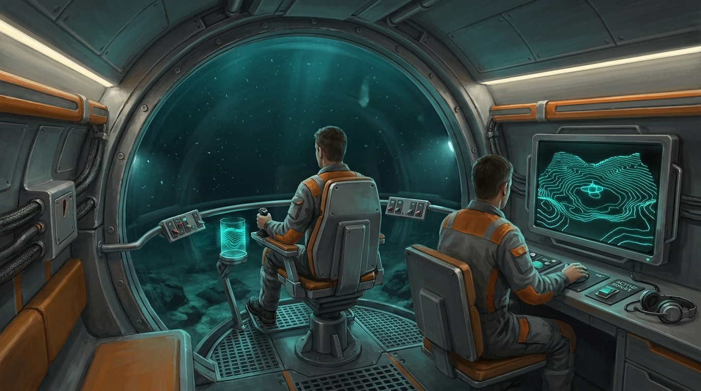
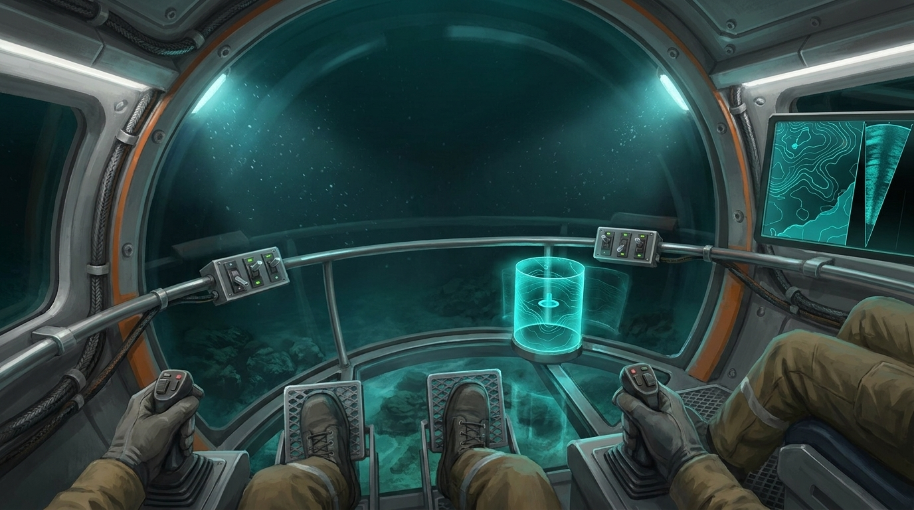
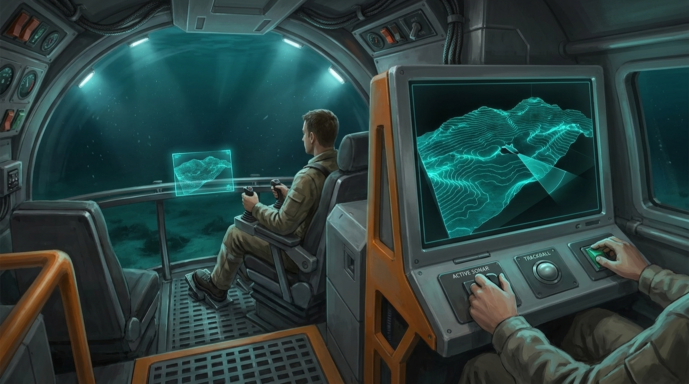
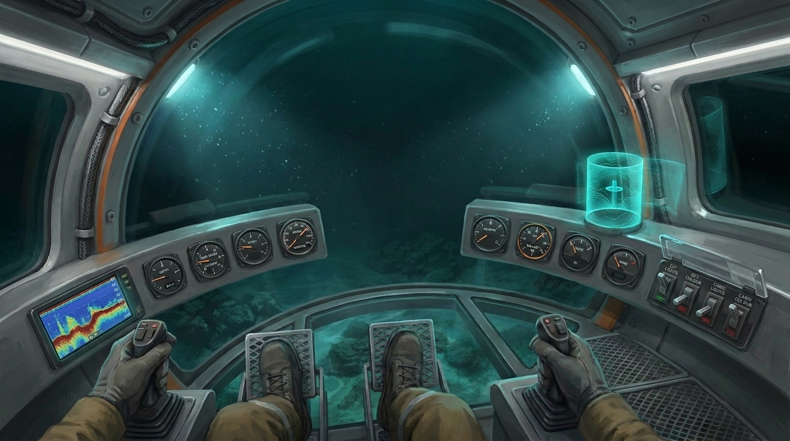

# Cockpit: concept

Concept record for the cockpit: the transparent dome at the nose of the sub and the two stations
that use it. Tracked in #328. The locked primary concept art is `cockpit_primary.png`;
`cockpit_pilot_view_reference.png` is the companion first-person shot of the pilot's station,
which did not change between the round it was drawn in and the locked arrangement, and
`cockpit_sonar_console_reference.png` is the reference for the sonar console itself: the layout
comes from the primary, the console's design from this shot. Everything else explored on the way
is linked below by commit permalink.

## The two stations

**Pilot.** Drives the sub. Controlled like modern heavy equipment: hand joysticks on the seat's
armrests and foot pedals for primary control, auxiliary controls (lights, ballast, pumps) on a
couple of small switch boards at seated elbow height. The pilot's field of view must stay almost
entirely on the dome, and seeing straight down at the sea floor matters, so the visual footprint
of the controls is small and there is glass, not floor, under the pilot's feet. A small
holographic projection, the map table's hologram in miniature, is locked centred on the sub; the
pilot may be allowed a little zoom but never pan or rotate.

**Sonar / navigator.** A co-pilot: operates the sonar to find and track contacts, and helps the
pilot decide where to go. Primary input is a large 2D screen in a classic bezel showing a rendered
view of the 3D terrain around the sub, centred on the sub by default. It is the operator's own
display, not shared with the pilot: they can zoom, pan and rotate it the way the map table is
operated, because they will sometimes want to look ahead or re-orient in ways that would not help
the pilot. Passive sonar is always on and fuzzy and must be pointed by hand in three dimensions;
active sonar paints everything but announces the sub's position, and is switched on and off here.
The screen shows where the passive array is pointed.

## Locked arrangement

- **The dome** is a single unbroken acrylic hemisphere, about 2.2 m across, with one heavy bolted
  steel ring at its rim and no mullions, bars or panes. Its floor is sunk one step below the main
  deck so a seated head sits near the dome's centre and crew standing behind can see out over it.
  **As built (#605):** a true sphere of radius 1.1 m, its ring plane at the pilot's z, its centre on the
  centreline 0.10 m under the seated eye (eye height 1.15 m above the cockpit floor, so the eye sits 0.10 m
  above the centre). The floor plane cuts the glass 0.05 m above the sphere's bottom, leaving a floor disc
  of glass 0.328 m in radius under the seat; the floor is 0.20 m below the main deck.
- **The pilot sits alone in the bubble**, seat on the centreline, well forward, glass all round
  and below. The bubble is small: a hand's width between the seat's armrests and the glass.
- **The sonar operator sits outside the dome**, just aft of the rim ring on the starboard side,
  on the main deck level (one step up from the pilot), on the aisle side of a console turned to
  the starboard hull, facing outboard (changed from the original aft-of-the-pilot, forward-facing seat by #586:
  the operator no longer looks past the pilot into the dome).
- Both seats are modern heavy-equipment operator seats on suspension pedestals with armrests.

**Pilot station** (the readouts and switches were re-planned on 2026-11-25: see "Pilot station, round 4"
below, which supersedes the rail and switch boards here)
- Two joysticks, one on each armrest.
- Two pedals on an open grating footrest with the glass continuing below it.
- A slim wraparound rail at seated elbow height carrying two small switch boards, kept out of
  the forward and downward view.
- The small hologram: a crisp cylinder of glowing teal contour lines about 20 cm across, the sub
  marker at its exact centre, mounted low on the rail's forward end on the centreline, below the
  sightline.

**Sonar station**
- A large 2D screen, about 55 cm wide, in a heavy modern bezel on the desk console, showing the
  terrain as glowing teal contour lines on black, the sub at centre, contact markers, and a wedge
  for the passive array's pointing direction.
- On the desk: a trackball (a joystick is the alternative) for pointing the array, a large
  guarded active sonar toggle with an indicator lamp, map controls (zoom, pan, rotate), and a
  headset on a hook.
- **The console as drawn in the sonar console reference is the one to build:** the screen in a
  deep bezel on a steeply raked desk with an orange-framed structure, and a slim control strip
  along its lower edge carrying the active sonar toggle, the trackball and the map keys under
  the operator's hands. The primary shot's flatter desk and smaller screen are superseded by it.

**Look.** Modern, utilitarian, reliable because it is overbuilt and well kept, not because it is
old. Powder-coated matte grey with safety-orange grab rails and accents, modern switch boards,
cove lighting, braided looms. See the "Modern, not antiquated" section of
[`docs/art_direction.md`](../../../../docs/art_direction.md), which this session added.

## Pilot station, round 4 (2026-11-25, #446)

Decided with Tristan while preparing the pilot station's brief, over three art rounds (the strip, the
multidisplay #458, the navball #459). Where this disagrees with the locked arrangement above, this wins. The
full specification is on #446.

- **One knee-height strip** low against the dome, in two wings with a **clear break at the apex** so the
  pilot sees straight ahead and down. The elbow-height rail and its switch boards are gone. Structure:
  `pilot_strip_primary.png` (a tilted fascia with orange-edged end caps either side of the gap).
  `pilot_strip_reference.png` shows the hologram up and to the side beside a letterbox depth finder.
- **Left wing, from the gap outward:** the **depth finder** (a 2D digital trace of the sea floor) with the
  **hologram** immediately above it; then the **speed / throttle** gauge and the **noise repeater** stacked on one facet.
- **Right wing, from the gap outward:** the **navball**, then the **multidisplay**; the three **warning lamps**
  (BILGE, CO2, LOW O2) run in one row along its top edge.
- **Light switches:** the four toggles (external on/off, external colour halogen or red, cabin on/off, cabin colour
  standard or red) are `lit_toggle`s at the seat's armrest anchors, not on the strip.
- **As built against the true hemisphere (#686, replacing the #605 stopgap):** two equal wings with an apex gap of at
  least 400 mm (about 700 mm as built, because the glass sets where the wings can start), the larger multidisplay and
  navball, and a forward-view check: the depth finder, hologram, navball and multidisplay centres lie within 70 degrees
  of the seated eye's forward axis. The limit moved from 35 to 60 to 70 because the strip lies along a 2.2 m
  hemisphere, 0.25 to 0.5 m below the eye; 35 was out of reach.
- **Speed / throttle:** two needles, centred, the speed scale at plus and minus the sub's top forward speed,
  computed from the physics model so it follows tuning.
- **Multidisplay (#458):** a configurable round display, with four widget slots, rate chevrons and a
  segmented ring. On the pilot it shows depth, the ballast air/water pie, buoyancy, height above the sea
  floor, vertical rate as chevrons, and air remaining on the ring. Housing from
  `multidisplay_housing_reference.png`; face content and style from `multidisplay_face_reference.png`.
- **Navball (#459):** a ball held fixed to the world (apex up, N to north), so heading, pitch and roll show
  through its motion behind a fixed orange reticle. It has HDG and PITCH digit windows and the
  multidisplay's housing. Housing from `navball_housing_reference.png`; readouts and reticle from
  `navball_readouts_reference.png`.
- **Hologram:** the map table's display model, small and always centred on the sub, zoom on the mouse
  wheel. Keeping terrain from hiding the sub and flipping the view when going astern are held for later
  (#455).
- **Inputs.** The keys stay and the controls move with them. The left joystick shows the throttle (W/S);
  the right joystick shows the planes (R/F) fore and aft and the rudder (A/D) side to side; the pedals are
  decoration. Ballast is on the keyboard (Numpad 8 blows, Numpad 2 floods): the pilot runs ballast
  directly (#445).
- **Shelved:** pitch and heading gauges (the navball covers both); depth, vertical speed, buoyancy and
  ballast/air gauges (the multidisplay covers them); water temperature.
- **Pilot seat.** A pilot-specific seat building on the generated `operator_seat`: armrest joysticks,
  pedals on a grating footrest, and a headrest.
- Unchosen round 1 images, by commit permalink:
  [strip variant 1](https://github.com/tsebens/silent_water/blob/2e5d832e8368aa3ddf5fb7f5039f806d3de5826e/concepts/pilot/strip_var1.png?raw=true),
  [navball variant 2](https://github.com/tsebens/silent_water/blob/d551f1173208e0eecf208f617b8dd83ee0efe223/concepts/pilot/navball_var2.png?raw=true).

## What was explored

Three rounds of generated concept art, all on #328. Model: the asset pipeline's `google-pro`
image provider (Gemini). References on every call: `exterior_vision_tristan.webp` (the dome from
outside, with the two seated figures that set the packing), the locked map table concept for the
hologram style, and the contour-line reference. Later rounds also passed the liked shot from the
round before.

### Round 1: four arrangements, both seats in the dome (commit `3b02e98`)

Three shots each: from behind the seats, the pilot's view, the sonar operator's view.

| Variant | Idea | Outcome |
| --- | --- | --- |
| 1 Centre pedestal | One low console between the seats carrying both stations' secondary controls; screen on a rigid floor arm | Not chosen |
| 2 Side consoles | Each station with its own outboard console at elbow height; screen set into the sonar desk | Not chosen |
| 3 Overhead boards | Aircraft-style overhead switch panel; hologram on a floor stalk; screen on an articulated arm from the rim | Not chosen; its pilot's view was the cleanest of the round |
| 4 Staggered seats | Sonar seat 40 cm aft and raised so the screen sits behind the pilot's sightline; pilot on a slim elbow-height rail | **Chosen**, but too spacious |

Links: [v1 behind](https://github.com/tsebens/silent_water/blob/3b02e98aaf3a8abc91079a78a827fde17201d841/concepts/cockpit/cockpit_var1_img1.png?raw=true), [v1 pilot](https://github.com/tsebens/silent_water/blob/3b02e98aaf3a8abc91079a78a827fde17201d841/concepts/cockpit/cockpit_var1_img2.png?raw=true), [v1 sonar](https://github.com/tsebens/silent_water/blob/3b02e98aaf3a8abc91079a78a827fde17201d841/concepts/cockpit/cockpit_var1_img3.png?raw=true), [v2 behind](https://github.com/tsebens/silent_water/blob/3b02e98aaf3a8abc91079a78a827fde17201d841/concepts/cockpit/cockpit_var2_img1.png?raw=true), [v2 pilot](https://github.com/tsebens/silent_water/blob/3b02e98aaf3a8abc91079a78a827fde17201d841/concepts/cockpit/cockpit_var2_img2.png?raw=true), [v2 sonar](https://github.com/tsebens/silent_water/blob/3b02e98aaf3a8abc91079a78a827fde17201d841/concepts/cockpit/cockpit_var2_img3.png?raw=true), [v3 behind](https://github.com/tsebens/silent_water/blob/3b02e98aaf3a8abc91079a78a827fde17201d841/concepts/cockpit/cockpit_var3_img1.png?raw=true), [v3 pilot](https://github.com/tsebens/silent_water/blob/3b02e98aaf3a8abc91079a78a827fde17201d841/concepts/cockpit/cockpit_var3_img2.png?raw=true), [v3 sonar](https://github.com/tsebens/silent_water/blob/3b02e98aaf3a8abc91079a78a827fde17201d841/concepts/cockpit/cockpit_var3_img3.png?raw=true), [v4 behind](https://github.com/tsebens/silent_water/blob/3b02e98aaf3a8abc91079a78a827fde17201d841/concepts/cockpit/cockpit_var4_img1.png?raw=true), [v4 pilot](https://github.com/tsebens/silent_water/blob/3b02e98aaf3a8abc91079a78a827fde17201d841/concepts/cockpit/cockpit_var4_img2.png?raw=true), [v4 sonar](https://github.com/tsebens/silent_water/blob/3b02e98aaf3a8abc91079a78a827fde17201d841/concepts/cockpit/cockpit_var4_img3.png?raw=true).

Feedback: variant 4 best overall but too spacious; the exterior art shows how tightly two people
fill the bubble. And the interior had drifted toward a WW2 submarine look (rivets, brass, valve
wheels, antique dials, stencils, caged lamps), which is wrong: the sub is modern. That feedback
became the "Modern, not antiquated" section of the art direction doc.

### Round 2: variant 4 tightened and modernised (commit `fd8db5f`)

Variant 5. Four shots: [behind](https://github.com/tsebens/silent_water/blob/fd8db5f8a7ea8cad1aeda01a8fa11e638c7915d5/concepts/cockpit/cockpit_var5_img1.png?raw=true),
[pilot's view](https://github.com/tsebens/silent_water/blob/fd8db5f8a7ea8cad1aeda01a8fa11e638c7915d5/concepts/cockpit/cockpit_var5_img2.png?raw=true) (now `cockpit_pilot_view_reference.png`),
[sonar's view](https://github.com/tsebens/silent_water/blob/fd8db5f8a7ea8cad1aeda01a8fa11e638c7915d5/concepts/cockpit/cockpit_var5_img3.png?raw=true),
[profile from port](https://github.com/tsebens/silent_water/blob/fd8db5f8a7ea8cad1aeda01a8fa11e638c7915d5/concepts/cockpit/cockpit_var5_img4.png?raw=true).

Feedback: the from-behind shot captures the size and spacing well, and the sonar display sitting
immediately behind the pilot was the intriguing part. Run with it.

### Round 3: pilot alone in the dome (commit `0c415a8`)

Variant 6. The sonar station moves out of the bubble to a desk just aft of the rim ring,
starboard. [From behind](https://github.com/tsebens/silent_water/blob/0c415a8795b888ffa11997e97c031850dc9e3e90/concepts/cockpit/cockpit_var6_img1.png?raw=true) (now `cockpit_primary.png`, **locked**) and
[the sonar operator's view past the pilot](https://github.com/tsebens/silent_water/blob/0c415a8795b888ffa11997e97c031850dc9e3e90/concepts/cockpit/cockpit_var6_img2.png?raw=true) (now `cockpit_sonar_console_reference.png`).

Feedback: the first shot's layout is the better one, but the sonar console as drawn in the
second is better than the first's. Both are kept: layout from the primary, console from the
reference.

## Decisions made in this session

1. **The pilot has the bubble to themself.** The whole dome, including the glass under their
   feet, is the pilot's view. This came out of the staggered-seat idea: once the sonar seat moved
   aft to keep the screen out of the pilot's sightline, moving it out of the dome altogether was
   the cleaner version.
2. **The sonar station is a desk with a screen, just aft of the dome on the starboard side.** The
   operator keeps a forward view past the pilot's seat and gives up the side and downward views.
   The screen can be as large as the operator likes without ever crossing the pilot's sightline.
3. **Two displays, not one.** The pilot's small hologram is locked centred on the sub; the sonar
   operator has their own 2D screen with a free camera. They are not shared, because the operator
   will sometimes want to look where the pilot should not be distracted.
4. **The sonar display is a 2D screen in a bezel, not a hologram.** That distinguishes it from the
   map table and the pilot's projection, and fits a station that is operated rather than glanced at.
5. **Excavator-style pilot controls.** Armrest joysticks and pedals, with auxiliary switch boards on
   an elbow-height rail, so the controls' visual footprint stays small.
6. **Open grating under the pilot's feet** with the glass continuing below.
7. **Modern, not antiquated**, written into `docs/art_direction.md`.
8. **The packing is set by the exterior art:** the bubble is small and a seated person fills it.

## Liked

- The pilot's view with nothing below the sightline but the hologram cylinder (round 2).
- The seat spacing and finish of round 2's from-behind shot.
- The sonar screen immediately behind the pilot.
- The sonar console as drawn in round 3's sonar view: raked desk, deep bezel, orange frame,
  control strip under the hands.

## Actively rejected

- Both seats side by side in the dome with room to spare (round 1 as drawn): too spacious.
- The WW2 submarine look: rivets, brass, bare rust, valve hand-wheels, antique dials in brass
  bezels, stencilled lettering, caged incandescent lamps.
- Mullions, bars or panes across the dome glass. Two round-1 shots drew them and were discarded.
- Any solid floor in front of the pilot's seat.

## Not chosen (not rejected)

- Centre pedestal console, side consoles, overhead switch boards (round 1 variants 1 to 3).
  The overhead board is worth remembering if the pilot's rail turns out to block too much.
- The staggered two-seats-in-the-dome arrangement (variant 4 and 5), superseded by the lock.

## Open questions and follow-ups

- **Sonar seat height.** The locked shot draws the sonar seat level with the pilot's; the dome
  floor is one step down, so the sonar seat should sit a step higher, on the main deck.
- **The pilot's hologram** should always be the small cylinder; several shots drew it as a flat
  panel. Whether the pilot gets any zoom control is still open.
- ~~Trackball or joystick for pointing the passive array.~~ Decided: the trackball (#349).
- **The sub experiment's layout** (`program.yaml` and `brief_cockpit_concept.md` on the sub
  experiment branch) still has two seats in the cockpit and an "old" sub. Both need revising to
  this concept when that branch lands: sonar becomes a midships station just aft of the dome,
  starboard, and the brief's materials list follows the art direction doc.
- **The map table concept** was reworked after this session's lock, in #329 (hull-side cab cowl, modern
  finish); its concept doc in `assets/models/map_table/concept/` is the current lock, and the round-1
  shots linked above show the earlier circular table that the pilot's hologram style was taken from.
- **Crew standing behind** now look over one head, not two; worth checking in the blockout.
- **A red-light variant** has not been drawn for any shot yet.
