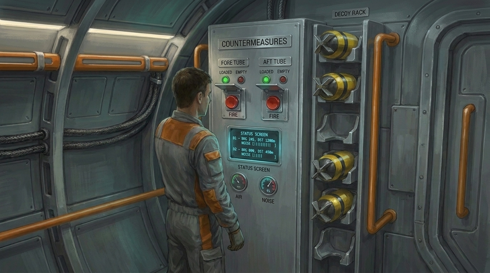
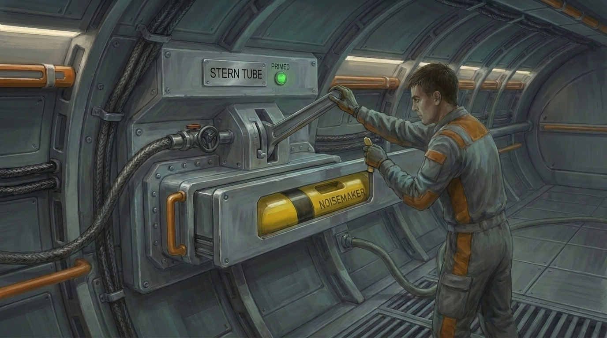

# Countermeasures: concept

Concept record for the countermeasures: the **control station** on the starboard wall at the bulkhead, and two
**decoy loaders** (launch tubes), one fore and one aft, mounted against the hull wherever there is room. Design
on #166; the sound field the decoys use is #725 (M19).

## Locked (Tristan, 2026-11-27)

### The control station

Round 1, station variant 1: **a tall flat panel with a decoy rack beside it**, flat against the hull and out of
the aisle, a sibling of the life support unit.

- **FORE TUBE** and **AFT TUBE** sections, each with LOADED / EMPTY lamps and a big **guarded FIRE** button under a
  flip cover.
- A **status screen** listing the decoys in the water (bearing, distance, a noise bar).
- **AIR** (launch air reserve) and **NOISE** gauges.
- **The decoy rack:** a column of cradles beside the panel, the count readable at a glance.

### The decoy loader

Round 2, drawer variant 2: **a drawer loader with a viewing window**. The motion is distinct from every other
motion in the sub:
1. slide the drawer open;
2. lay the decoy in;
3. slide it closed (the decoy shows through the window);
4. pull the lever above it down to **lock and prime**.

It has an orange pull handle, a STERN TUBE / FORE TUBE plate, a PRIMED lamp, and the compressed-air line feeding it.
It mounts against the hull wall wherever there is space; where each tube goes is settled later.

### The decoy

A **little fat torpedo**: stubby and round-nosed, with a small finned tail cap, yellow with a black band, a NOISEMAKER
label and a carry handle. "Fun to haul around." It is carried by hand from the rack to a loader, like the scrubber
canisters. Never a weapon.

## Not chosen (permalinks)

- Round 1: [station variant 2](https://github.com/tsebens/silent_water/blob/74c7514e41ca1b0781e6cb99509b23655d21678e/concepts/countermeasures/cm_station_var2.png?raw=true),
  [station variant 3](https://github.com/tsebens/silent_water/blob/74c7514e41ca1b0781e6cb99509b23655d21678e/concepts/countermeasures/cm_station_var3.png?raw=true),
  [tube variant 1](https://github.com/tsebens/silent_water/blob/74c7514e41ca1b0781e6cb99509b23655d21678e/concepts/countermeasures/cm_tube_var1.png?raw=true),
  [tube variant 2](https://github.com/tsebens/silent_water/blob/74c7514e41ca1b0781e6cb99509b23655d21678e/concepts/countermeasures/cm_tube_var2.png?raw=true),
  [tube variant 3](https://github.com/tsebens/silent_water/blob/74c7514e41ca1b0781e6cb99509b23655d21678e/concepts/countermeasures/cm_tube_var3.png?raw=true) (the drawer idea).
- Round 2: [drawer variant 1](https://github.com/tsebens/silent_water/blob/52f0a0cbbf85dd4608ac073d58ff37e446a48676/concepts/countermeasures/cm_drawer_var1.png?raw=true),
  [drawer variant 3](https://github.com/tsebens/silent_water/blob/52f0a0cbbf85dd4608ac073d58ff37e446a48676/concepts/countermeasures/cm_drawer_var3.png?raw=true).
- Round 3, the cylindrical versions, set aside for now:
  [1](https://github.com/tsebens/silent_water/blob/a43e44e184f5995c75aba8afa6e1cb7b6213a5c7/concepts/countermeasures/cm_cyl_var1.png?raw=true),
  [2](https://github.com/tsebens/silent_water/blob/a43e44e184f5995c75aba8afa6e1cb7b6213a5c7/concepts/countermeasures/cm_cyl_var2.png?raw=true),
  [3](https://github.com/tsebens/silent_water/blob/a43e44e184f5995c75aba8afa6e1cb7b6213a5c7/concepts/countermeasures/cm_cyl_var3.png?raw=true).
