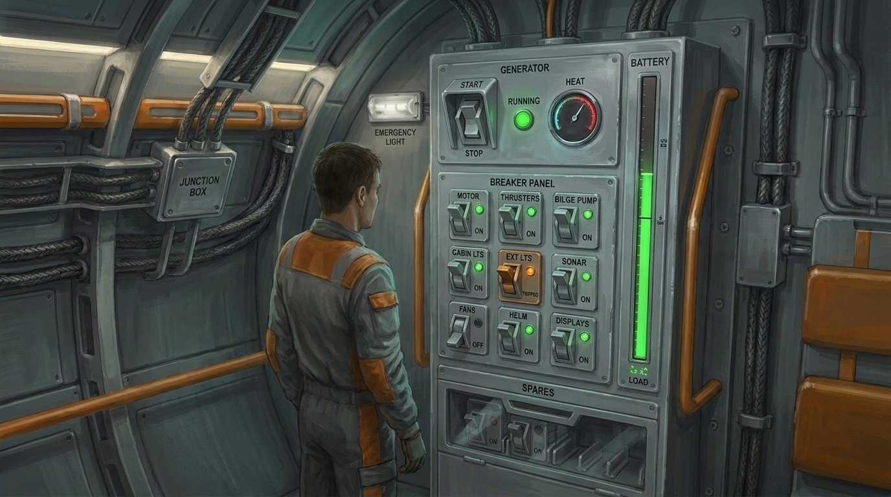
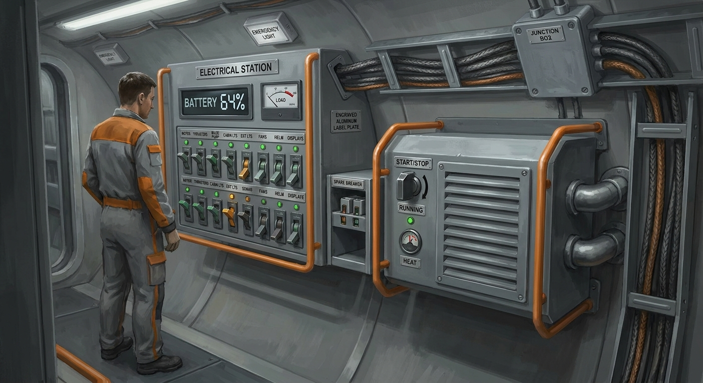

# Electrical station: concept

Concept record for the electrical station, the breaker panel, battery and generator controls on the
starboard wall of the engineering compartment. Tracked in #534; the power system it runs is Decision #533 and
the design doc's *Power and electrics* section. The locked art is `electrical_primary.png`.

## Locked (Tristan, 2026-11-26)

**Round 1, variant 1: a distribution board.** A tall flat wall board from knee to head height, flat against
the hull so it takes almost nothing from the aisle, styled as a sibling of the life support unit across the
aisle:

- **Generator** section at the top: a guarded START/STOP switch, a RUNNING lamp and a HEAT gauge.
- **Breakers:** nine in a 3 × 3 grid, each a chunky toggle with its own status lamp and engraved label:
  MOTOR, THRUSTERS, BILGE PUMP, CABIN LTS, EXT LTS, SONAR, FANS, HELM, DISPLAYS. On, tripped (amber, handle
  mid-way) and off (dark) must read at a glance.
- **Battery:** a tall bar meter down the right edge.
- **Load meter: from variant 3.** An analogue LOAD meter (needle, red zone at the top) beside the battery
  readout, so the crew sees what is drawing on the battery. Variant 1's small load indicator is replaced by it.
- **Spares:** a clear-fronted drawer of spare breaker modules at the bottom.
- **Cable trays** leave the board along the hull, with a bolted **junction box** on the run (where a damaged
  line sparks).
- **Emergency lights** on the wall above.

## For later: a visible generator

Variant 3 put the **generator itself** on the wall beside the board: a boxy louvred unit with exhaust pipework
into the hull, carrying its own start, running lamp and heat gauge. Not needed now (the generator stays out
of sight), but kept as a direction worth taking later: it makes the loud thing a physical object the crew
can stand next to and gives its heat a body. Its board (16 breakers, repeated labels) is not a reference.
Its **load meter** is used now (above).

## Not chosen

[Variant 2, the switch desk](https://github.com/tsebens/silent_water/blob/e98f80a0b5ad12d615d2186750ead1c1146c4c74/concepts/electrical/electrical_var2.png?raw=true):
a waist-high console with the breakers in one row on a sloped desk. It pushed further into the narrow aisle.
