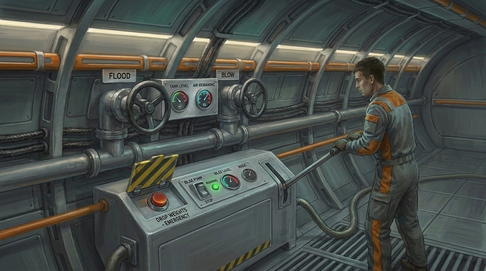

# Engineering station: concept

Concept record for the engineering station, the crew's "staying afloat by hand" station on the port side of the
engineering compartment: the manual ballast backup, the emergency drop-weight release, and the bilge. Tracked in
#530; the split from the electrical station is Decision #533. The locked art is `engineering_primary.png`.

## Locked (Tristan, 2026-11-26)

**Round 1, variant 2: wheels on the hull, pump in the console.** "The layout is simple, the look is distinct
from the other stations." Where the life support unit and the electrical board are wall units, this one is
plumbing:

- **Ballast backup:** the FLOOD and BLOW **wheels** sit on heavy valve bodies on visible **ballast pipework**
  running along the port hull at chest height, labelled above. Between them, a small plate carries the **TANK
  LEVEL** and **AIR REMAINING** gauges. The wheels are plainly on the pipes they open.
- **A low console** beneath the pipework carries:
  - the **DROP WEIGHTS - EMERGENCY** button under a hinged, hazard-striped flip guard;
  - the electric **BILGE PUMP** switch with its **RUNNING** lamp;
  - the **BILGE LEVEL** gauge;
  - the **NOISE** repeater.
- **The manual bilge pump** is built into the console: its long lever comes out of the console's end and
  swings up and down, with the hose running to the bilge-well grating. Hold E for the down stroke, release and
  it springs back, wait a beat for the cylinder to refill, repeat. Slow, quiet, and needs no power.

To check when it is built:
- The pump lever's sweep must leave the aisle passable (`program.yaml` `aisle_min_m`), or be laid out so it
  does.
- The console's gauges sit low: they must still read from the standing eye.
- The palette asks for orange on what is touched. The art's wheels are dark steel; the brief decides.

## Not chosen

- [Variant 1, one wide console](https://github.com/tsebens/silent_water/blob/1ecd6bc33f3321a6babc9a8af419682147ce3176/concepts/engineering/engineering_var1.png?raw=true):
  the clearest read, but wider than the ballast slot, and too close in kind to the other wall units.
- [Variant 3, ballast column and bilge corner](https://github.com/tsebens/silent_water/blob/1ecd6bc33f3321a6babc9a8af419682147ce3176/concepts/engineering/engineering_var3.png?raw=true):
  the best fit to the old layout (a column in the ballast slot, a bilge unit on the well).

## Open (from #530)

- What dropping the weights costs.
- The hand pump's volume per stroke and timing against the leak rate.
