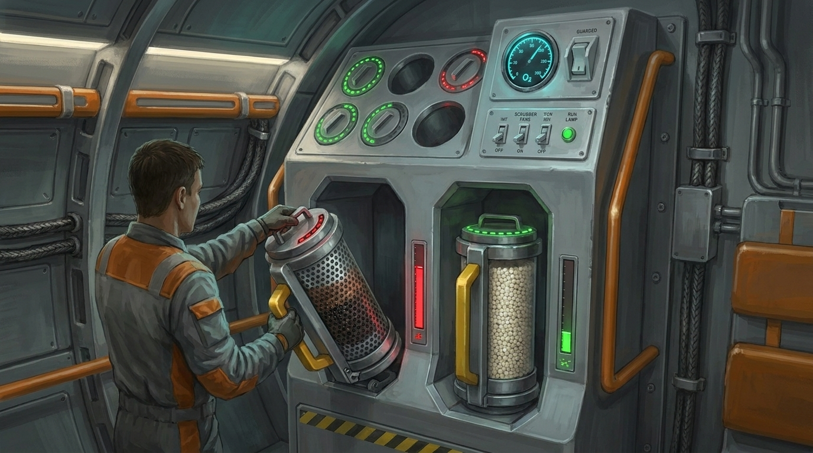
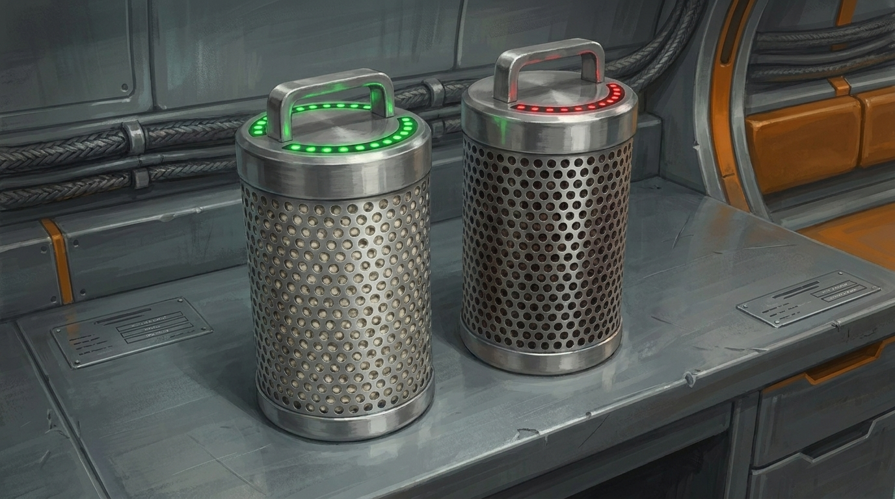
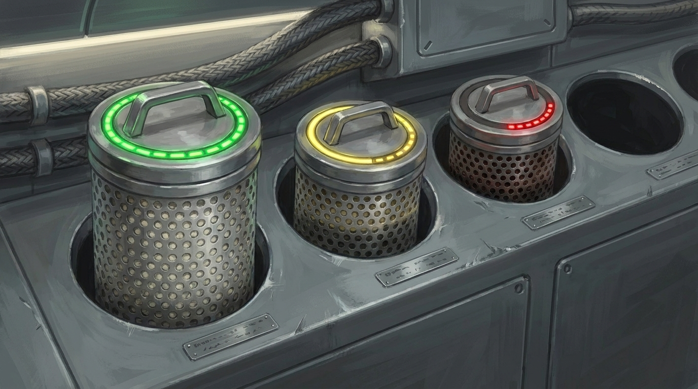

# Life support station: concept

Concept record for the life support station and the CO2 scrubber canisters. Tracked in #424; the
mechanics are in the design doc's *Life support: CO2 and O2* section (#421). The locked primary
concept art is `life_support_primary.png` (the station) and `scrubber_canister_primary.png` (the
canister); `scrubber_canister_storage_reference.png` shows the canisters' indicator rings as seen in
storage, and `reference/life_support_interaction.pdf` is Tristan's diagram series of the swap.
Everything else explored is linked below by commit permalink.

## What the station is for

Crew keep the sub's CO2 down by swapping scrubber canisters, and watch the O2 level. Two active ports
each hold one canister and show its saturation on a vertical gauge; six storage holes hold the spares
and the spent ones. See the design doc for the CO2 model, the pacing target (one canister lasts four
crew about 15 minutes) and the effects of rising CO2.

## Locked concept: the station

**Where it is.** Against the **port side hull of the engineering bay** (`program.yaml` station
`life_support`: engineering, port, about 1.0 m wide), **not against the aft bulkhead**. The primary
image draws it on an end wall; that is a composition slip, and the unit, its proportions and its
panel arrangement are what is locked. Build it on the curved side hull.

**The unit**, top to bottom, as drawn:
- **Upper panel:** six **storage holes** in two rows of three, canisters dropping in to leave their
  tops and light rings visible (four fresh, two empty on a new sub); the **O2 gauge**, a single round
  backlit gauge with cyan markings on black, with a guarded switch beside it; a small bank of three
  light-grey **fan toggles** with a green run lamp.
- **Alcove** at chest height, chamfered, holding the **two active ports** side by side. Each port is a
  minimal open cradle: a shallow socket the canister stands in with a yellow handle, lifted straight
  out and dropped back in. No door, no pivot.
- Beside each port a **vertical linear gauge**, a slim backlit window whose bar shows remaining capacity,
  full when fresh and draining: green above 50% remaining, yellow from 50% to 15%, red below 15%. (The
  primary image drew it filling with saturation; the design now reads it the other way.) Left port in the
  primary is spent (being removed), right port fresh.
- **Not in the primary image, added to the design after the lock:** a **double-needle rate gauge** on the
  panel. Capacity needle: the scrubbers' maximum achievable CO2 removal rate at their current saturation.
  Production needle: the crew's current CO2 production rate. Production above capacity means CO2 is rising.
  Its place on the panel is open; the upper panel beside the O2 gauge is the natural spot. It is the shared
  `Gauge` (`src/interact/gauge.gd`) with its second needle (`readout_b`) in the palette's existing readout
  colours; no new swatches.
- A hazard-striped plinth below the alcove.
- Finish: powder-coated matte grey with safety-orange grab rails round it, engraved plates with no
  text, in line with the "Modern, not antiquated" section of `docs/art_direction.md`.

**The swap**, as the primary shows it: lift the spent canister out of its cradle, drop it in an empty
storage hole, lift a fresh one from storage, drop it in the cradle. The gauge beside the port resets
when a fresh canister seats.

**Future addition, not in the lock: the pivoting carriage.** Tristan's diagrams
(`reference/life_support_interaction.pdf`) show each active port as a carriage that holds the
canister upright and pivots at its base, so opening tilts the canister out toward the player and
closing swings it back in. The minimal open cradle is chosen for now; the carriage stays on the table
as a later upgrade to the swap's feel.

## Locked concept: the canister

- A cylinder about 30 cm tall and 15 cm across, its wall a perforated steel sheet showing the fill of
  **absorbent beads**: pale off-white when fresh, darkening through brown to near black as it
  saturates, so a spent canister looks spent from across the bay.
- A solid top cap with a **carry handle** and a **ring of indicator lights** round the top edge
  (about 300 degrees): all lit and green when fresh, fewer and yellow part-used, a short red arc when
  spent. Readable when only the top shows in a storage hole.

## What was explored

One round of generated concept art on #424 (commit `318df8c`): the asset pipeline's `google-pro`
image provider (Gemini), with the reference canister photo and the locked cockpit concept (for the
interior finish) as references. Three storage arrangements, each with a whole-unit shot and a swap
shot, plus two canister details.

| Variant | Storage | Outcome |
| --- | --- | --- |
| 1 Top shelf | Six holes above the alcove, as diagrammed | **Chosen** (its swap shot is the lock); the whole-unit shot drew the holes on a sloped shelf |
| 2 Bottom rack | A row of six at waist height below the alcove | Not chosen; its swap shot was the best render of the pivoting carriage |
| 3 Flanking columns | Two columns of three either side of the alcove | Not chosen; the holes rendered as dials |

Links: [v1 unit](https://github.com/tsebens/silent_water/blob/318df8cbe60543a5a562057812adfc780499f8d8/concepts/life_support/life_support_var1_img1.png?raw=true), [v1 swap](https://github.com/tsebens/silent_water/blob/318df8cbe60543a5a562057812adfc780499f8d8/concepts/life_support/life_support_var1_img2.png?raw=true) (now `life_support_primary.png`), [v2 unit](https://github.com/tsebens/silent_water/blob/318df8cbe60543a5a562057812adfc780499f8d8/concepts/life_support/life_support_var2_img1.png?raw=true), [v2 swap](https://github.com/tsebens/silent_water/blob/318df8cbe60543a5a562057812adfc780499f8d8/concepts/life_support/life_support_var2_img2.png?raw=true), [v3 unit](https://github.com/tsebens/silent_water/blob/318df8cbe60543a5a562057812adfc780499f8d8/concepts/life_support/life_support_var3_img1.png?raw=true), [v3 swap](https://github.com/tsebens/silent_water/blob/318df8cbe60543a5a562057812adfc780499f8d8/concepts/life_support/life_support_var3_img2.png?raw=true), [storage tops](https://github.com/tsebens/silent_water/blob/318df8cbe60543a5a562057812adfc780499f8d8/concepts/life_support/life_support_canister_img3.png?raw=true) (now `scrubber_canister_storage_reference.png`), [fresh vs spent](https://github.com/tsebens/silent_water/blob/318df8cbe60543a5a562057812adfc780499f8d8/concepts/life_support/life_support_canister_img4.png?raw=true) (now `scrubber_canister_primary.png`).

## Decisions

1. **Variant 1's arrangement is the station:** storage holes and the O2 panel above, the two active
   ports in a chest-height alcove with a vertical gauge each, plinth below.
2. **The station lives on the port side hull of engineering,** not an end wall, whatever the primary
   image shows.
3. **Minimal open cradles for the active ports**, lifted straight out; the pivoting carriage from the
   diagrams is a possible future addition.
4. **The canister is the fresh-versus-spent pair:** perforated wall, beads that darken, carry handle,
   ring of indicator lights round the top.
5. The indicator rings on the canister tops are liked and are the way state is read in storage.

## Liked

- The whole panel arrangement of the primary.
- The ring of indicator lights on each canister's top.
- The beads visible through the perforations, and their darkening.

## Not chosen (not rejected)

- Bottom-rack and flanking-column storage.
- The pivoting carriage (kept as a future addition).

## Open questions and follow-ups

- The O2 gauge's exact place on the panel, and whether a guarded switch belongs beside it.
- Where the double-needle rate gauge sits on the panel.
- How many fan toggles the station really has; the brief's `functions` list decides, not the art.
- Whether the storage holes should be angled toward the player so the rings read from the aisle.
- A red-light shot has not been drawn; indicator rings and gauge colours must be checked under it,
  since paint colour coding collapses under stealth red (`docs/palette.md`).

## For the station brief

Suggested `concept.images` entries once the brief is written:

| path | role | view | camera |
| --- | --- | --- | --- |
| `assets/models/life_support/concept/life_support_primary.png` | primary | three-quarter from the operator's left shoulder at chest height, left port open | `swap_left` |
| `assets/models/life_support/concept/scrubber_canister_primary.png` | context | two canisters on a bench, three-quarter, product-shot | `canister_pair` |
| `assets/models/life_support/concept/scrubber_canister_storage_reference.png` | context | storage tops from slightly above | `storage_tops` |

`compare_on`: massing of the unit, the alcove's position and proportion, the two ports side by side
with a vertical gauge beside each, storage holes above in two rows of three, the O2 gauge on the upper
panel. The double-needle rate gauge is not in the art and is placed by the brief's `functions`, not the
concept. `ignore`: the number and labels of switches, the wall the unit stands on, lighting mood, the
person, the beads' exact colour.
