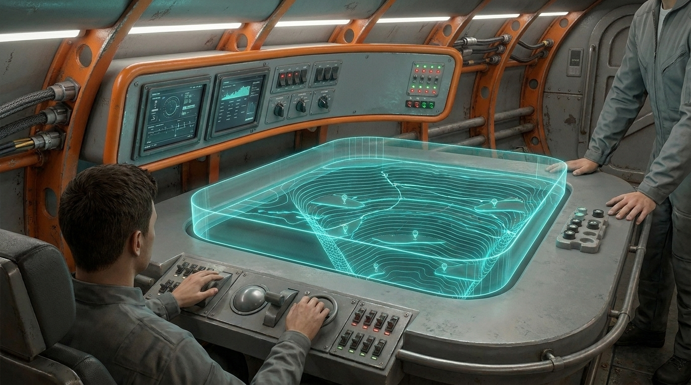

# Map table: concept

Concept record for the map table. Tracked in #319 (the free-standing circular table, rounds 1 to 3)
and #329 (the table moved to the hull side, rounds 4 and 5). The locked primary concept art is
`map_table_primary.png` in this folder; `map_table_operator_reference.png` is the companion shot
from the seated operator's eye level. Everything else explored on the way is linked below by commit
permalink.

## What the table is for

The map table gives crew who are not operating a station a sense of spatial coordination: what is
outside, where the sub is going and how to get there. It shows a **subset of the whole chart**.

- **One operator** controls the rendering camera: zoom, pan, rotate. The camera is theirs alone.
- **Up to three observers** stand along the table. They can place markers and lines (a line is a
  sequence of waypoint markers) but cannot move the camera.
- Thematically it is the most advanced kit on the sub. The table's surface is a 3D hologram.

The cockpit concept brief (`assets/models/vehicles/sub_interior/brief_cockpit_concept.md` on the
sub experiment branch) imagined one shared chart at three stations. The cockpit concept (#328) settled
that: the pilot has a small locked hologram, the sonar operator a 2D screen, and the map table is the
crew's planning view.

## Locked concept

**Where it lives**
- Built into a **bay in the port side wall** of midships, between two hull frames, running
  fore-and-aft along the hull. One aisle in front of it; nobody stands behind it. The sonar
  operator sits on the starboard side just aft of the pilot, so the table takes port.
- The sub is small and the interior must feel cramped and packed. The earlier free-standing
  circular table with a walkway each side needed about 3.1 m of a 2.8 m compartment; the bay
  table leaves the whole aisle free.
- **Countermeasures** stands against the **starboard** wall, immediately aft of the sonar
  station, across the aisle from the table. Its operator glances across the aisle at the
  hologram to see their decoys work. (The interior program's earlier placement, starboard and
  forward of a central table, is superseded.)

**The table**
- A **D-shaped top**, about 2.2 m long and 0.9 m deep at the centre, its back edge following the
  curve of the hull and its front edge bowing gently out toward the aisle. A grey powder-coated
  plate with a **safety-orange edge rail**, on a single plinth, braced off the hull frames.
- **Desk height**, about 0.75 m, because the operator sits.
- The **operator sits at the middle of the front edge**, on a modern operator's seat, at the
  console built into the edge: a large trackball under one hand, a chunky zoom lever and a
  rotation hand-wheel under the other, a short row of guarded toggles with LED lamps. The locked
  shot inherited round 4's composition and seats them at the aft end of the D; **build it at the
  middle**, as round 5's variant 15 shows.
- **Observers stand** along the front edge either side of the operator, leaning in. They place
  markers by **clicking on the terrain**; the moulded **puck holders** on the front edge in the
  art are set dressing that reads as "markers live here", not an interaction.
- Above the table, wrapping round the bay like the inside of an excavator cab, is **one
  continuous curved instrument cowl** in powder-coated grey with an orange structural frame:
  flush screens in heavy bezels, rocker and toggle clusters, LED indicator rows, backlit modern
  gauge faces, and a white cove light along its top edge.
- **Modern, not antiquated** (`docs/art_direction.md`): welded and bolted steel and aluminium,
  matte grey with safety-orange accents, braided looms, engraved blank label plates, cove
  lighting and LED work lights. No rivets, brass, rust, valve wheels, antique dials, stencils or
  caged bulkhead lamps.

**The hologram**
- A **curved slab of light** standing on the table top with the same footprint as the top: its
  back face follows the curve of the hull, its front face is gently bowed toward the aisle, about
  0.7 m tall. Its faces are crisp, clearly defined, faintly glowing and translucent, dropping
  straight to the table, so the volume's outline is easy to keep track of from the aisle.
- It is **open to the air**: no glass, no cage, no posts, no frame, no lid.
- Terrain is drawn as glowing soft neon teal-cyan topographic contour lines on a dark base.
  Nothing else: no floating panels, no text, no icons.
- Pins are small glowing markers standing on the terrain. Routes are thin lines between pins.
- The slab is **filled**: terrain fills the volume out to its faces, and a pit is a hole in the
  surrounding plateau, as in the earlier locked shot. It never draws an isolated plug of terrain
  floating in empty light.
- The seated operator and the desk-height top give the slab its height under the 2.3 m overhead;
  the standing-height table had about 4.5 ft to play with and this has more.

The operator reference shows the console and the cowl from the seat. Its slab drifted to a
rounded rectangle; the curved slab of the primary is the one to build.

## What was explored

Five rounds of generated concept art. Model: the asset pipeline's `google-pro` image provider
(Gemini). Rounds 1 to 3 are on #319, rounds 4 and 5 on #329.

### Rounds 1 to 3: the free-standing circular table (#319)

Round 1 explored physical structure and crew positioning (operator's helm, plotting pedestal,
navigator's chart table, overhead projector); round 2 the plan shape (square, round, D, long
rectangle); round 3 terrain with extreme depth change on the chosen round table. The result was
locked as a circular 1.5 m table on a flanged column with a tall open cylinder of light, then
superseded by round 4. The full record of those rounds, with permalinks to every image, is the
earlier version of this file: [`map_table_concept.md` at `7f9a0c4`](https://github.com/tsebens/silent_water/blob/7f9a0c44b0a5c126209adaec0dceb4394257035f/assets/models/map_table/concept/map_table_concept.md), with its locked
[primary](https://github.com/tsebens/silent_water/blob/7f9a0c44b0a5c126209adaec0dceb4394257035f/assets/models/map_table/concept/map_table_primary.png?raw=true) and
[height reference](https://github.com/tsebens/silent_water/blob/7f9a0c44b0a5c126209adaec0dceb4394257035f/assets/models/map_table/concept/map_table_height_reference.png?raw=true).

What carried forward from those rounds: the open crisp-edged volume of light, the contour-only
terrain, operator controls built into the table, puck holders for observers, no enclosure.

### Round 4: the table moved to the hull side (commit `f4d1105`)

Feedback on the circular table: too big for midships. Push it to one side, let it elongate, give
it one open edge with a seated operator in the middle and up to three standing observers, and put
instruments on the curving wall above it. Three variants, two shots each (context from the aisle,
operator's eye level).

| Variant | Form | Outcome |
| --- | --- | --- |
| 10 Chart bench | Long rectangle, flat row of panels above, coaming at the back | Not chosen; shallow slab read as a glass block |
| 11 Alcove bay | D-shaped top in a bay between two frames, half-cylinder of light, instruments wrapped round as a cowl | **Chosen** as the layout to follow |
| 12 Cantilever shelf | Pill-shaped top on angled brackets, open deck beneath, taller slab, boxed modules with orange cove light | Not chosen; kept the crisp slab edges best |

Links: [var10 context](https://github.com/tsebens/silent_water/blob/f4d1105fca9a32527cb793a4bf28b2ab9d9025e5/concepts/map_table/map_table_var10_img1.png?raw=true), [var10 operator](https://github.com/tsebens/silent_water/blob/f4d1105fca9a32527cb793a4bf28b2ab9d9025e5/concepts/map_table/map_table_var10_img2.png?raw=true), [var11 context](https://github.com/tsebens/silent_water/blob/f4d1105fca9a32527cb793a4bf28b2ab9d9025e5/concepts/map_table/map_table_var11_img1.png?raw=true), [var11 operator](https://github.com/tsebens/silent_water/blob/f4d1105fca9a32527cb793a4bf28b2ab9d9025e5/concepts/map_table/map_table_var11_img2.png?raw=true), [var12 context](https://github.com/tsebens/silent_water/blob/f4d1105fca9a32527cb793a4bf28b2ab9d9025e5/concepts/map_table/map_table_var12_img1.png?raw=true), [var12 operator](https://github.com/tsebens/silent_water/blob/f4d1105fca9a32527cb793a4bf28b2ab9d9025e5/concepts/map_table/map_table_var12_img2.png?raw=true).

Decisions from the round: the operator sits (which sets the desk-height top and buys slab height);
port side; a curved slab that follows the hull. The round also leaned into a WW2 submarine look,
which prompted the "Modern, not antiquated" section of the art direction doc.

### Round 5: the alcove bay, modern (commit `bc404ae`)

Variant 11's context shot painted over in the modern art direction, with the locked cockpit
primary and sonar console shots as style references. Three variants, two shots each.

| Variant | Instruments above the table | Outcome |
| --- | --- | --- |
| 13 Cab cowl | One continuous curved cowl with an orange frame, cove light along its top | **Locked** |
| 14 Modular panels | Boxed modules on a curved orange rail, work lights on arms, orange hull frames | Not chosen; some rust crept onto the frames |
| 15 Liner desk | Smooth liner panels, cantilevered desk, one slim instrument strip, cove light under the desk | Not chosen; the only shot with the operator at the middle of the front edge |

Links: [var13 context](https://github.com/tsebens/silent_water/blob/bc404ae23b9c13b85d7d200b5ded13a54a560106/concepts/map_table/map_table_var13_img1.png?raw=true) (now `map_table_primary.png`), [var13 operator](https://github.com/tsebens/silent_water/blob/bc404ae23b9c13b85d7d200b5ded13a54a560106/concepts/map_table/map_table_var13_img2.png?raw=true) (now `map_table_operator_reference.png`), [var14 context](https://github.com/tsebens/silent_water/blob/bc404ae23b9c13b85d7d200b5ded13a54a560106/concepts/map_table/map_table_var14_img1.png?raw=true), [var14 operator](https://github.com/tsebens/silent_water/blob/bc404ae23b9c13b85d7d200b5ded13a54a560106/concepts/map_table/map_table_var14_img2.png?raw=true), [var15 context](https://github.com/tsebens/silent_water/blob/bc404ae23b9c13b85d7d200b5ded13a54a560106/concepts/map_table/map_table_var15_img1.png?raw=true), [var15 operator](https://github.com/tsebens/silent_water/blob/bc404ae23b9c13b85d7d200b5ded13a54a560106/concepts/map_table/map_table_var15_img2.png?raw=true).

## Liked

- The hologram as a slab of light with **sharp, defined edges** running from the terrain surface
  straight down to the table, so the shape is easy to track.
- A **curved slab** that follows the hull.
- **Operator controls built into the table**, and a **seated operator** on a modern seat.
- The table **in a bay in the hull wall**, with the instruments above it wrapping round as a cab
  cowl.
- The **modern** finish: powder-coated grey, orange structure and rails, cove lighting.

## Actively rejected

- **Any enclosure** around the hologram: glass box, corner-post cage, posts, rails, frame
  (round 1), and a **lid, cap, dome or metal ring** on the volume (rounds 3 and 4).
- **A free-standing table with a walkway each side.** Too big for the compartment (round 4).
- **The antiquated WW2 look:** rivets, brass, rust, valve wheels, antique dials, stencils, caged
  bulkhead lamps (rounds 1 to 4; see `docs/art_direction.md`).
- **A small map** sitting in the middle of a larger table (round 1).
- **Inverted terrain:** a pit drawn as a standing column (round 3).
- Generation slips, to be avoided in later passes: detailed faces on figures, legible text,
  dimension lines, corrosion on painted frames.

## Not chosen (not rejected)

- The circular table on a single column (rounds 2 and 3). It felt best as an object; it did not
  fit the boat.
- The long bench and the cantilever shelf (round 4), and the modular panels and liner desk
  (round 5).
- The two-handed yoke, tethered styluses, overhead projector and pendant (round 1).

## Open questions

None at present.

## Decisions recorded on #329

- The operator sits at the **middle** of the front edge, not the aft end of the D.
- The slab is **filled** with terrain to its faces; no isolated plug.
- **Countermeasures** goes against the starboard wall immediately aft of the sonar station,
  across the aisle from the table.
- **Markers are placed by clicking**, not by handling physical pucks. The puck holders in the art
  stay as dressing only.
