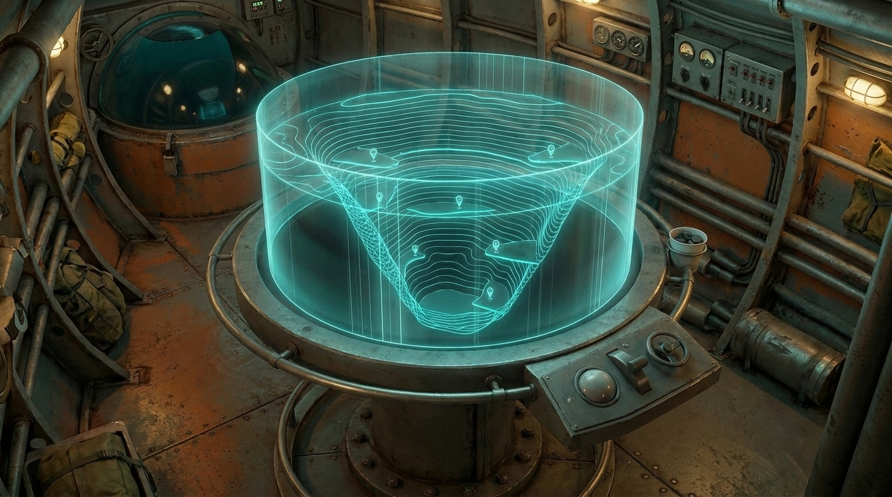
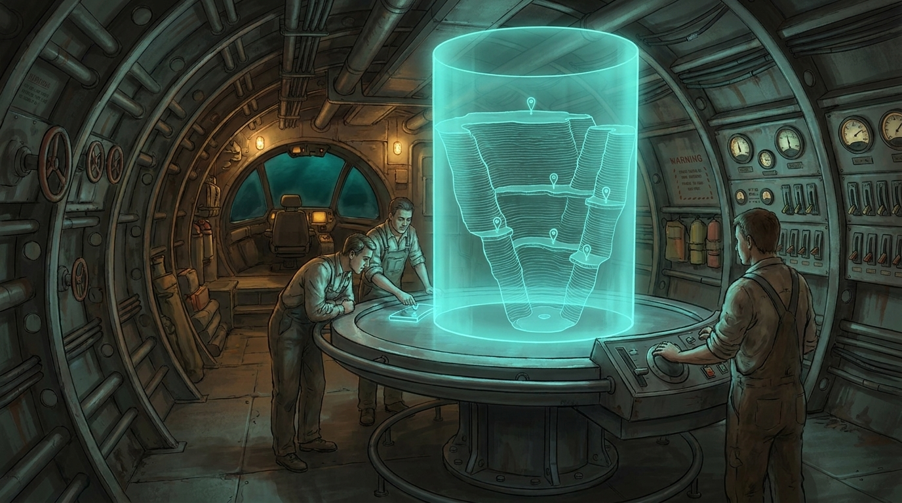

# Map table: concept

Concept record for the midships map table. Tracked in #319. The locked primary concept art is
`map_table_primary.png` in this folder; `map_table_height_reference.png` is the companion shot that
sets the hologram's height. Everything else explored on the way is linked below by commit permalink.

## What the table is for

The map table gives crew who are not operating a station a sense of spatial coordination: what is
outside, where the sub is going and how to get there. It shows a **subset of the whole chart**.

- **One operator** controls the rendering camera: zoom, pan, rotate. The camera is theirs alone.
- **Up to three observers** stand round the rest of the table. They can place markers and lines
  (a line is a sequence of waypoint markers) but cannot move the camera.
- Thematically it is the most advanced kit on the sub. The rest of the boat is deliberately
  low-tech because older tech is more reliable; the table's surface is a 3D hologram.

The cockpit concept brief (`assets/models/vehicles/sub_interior/brief_cockpit_concept.md` on the
sub experiment branch) imagined one shared chart at three stations. This table is designed on its
own; that combined scheme is not considered workable in practice.

## Locked concept

**The table**
- Circular top, **about 1.5 m across** (the map must stay within roughly 4 to 6 ft, 1.2 to 1.8 m).
- A single massive flanged column bolted to the deck, with a ring footrail round it.
- The operator's console is a **sloped wedge built into the rim** on the aft side: a large
  trackball under one hand, a chunky zoom lever and a rotation hand-wheel under the other, and a
  row of guarded toggle switches. The operator stands there facing forward toward the cockpit.
- Observers stand round the rest of the rim. A cup of small physical **marker pucks** is clamped
  to the rim at each observer position; setting a puck on the map drops a pin.
- Heavy, worn, bolted steel in the sub's orange-and-grey palette. Industrial, utilitarian,
  competent. No chrome, no white plastic, no LED strips.

**The hologram**
- A **cylinder of light** standing on the table top, the same diameter as the top. Its curved side
  is a crisp, clearly defined, faintly glowing translucent face that drops straight to the table,
  so the volume's outline is easy to keep track of from anywhere in the compartment.
- It is **open to the air**: no glass, no cage, no posts, no frame, no lid.
- Terrain is drawn as glowing soft neon teal-cyan topographic contour lines on a dark base, after
  the contour reference image. Nothing else: no floating panels, no text, no icons.
- Pins are small glowing markers standing on the terrain. Routes are thin lines between pins.
- **Height:** tall. `map_table_height_reference.png` shows the preferred height, with the top of
  the cylinder just under the overhead pipes. See the open questions on headroom.

**Terrain with extreme depth change** (what the locked shot shows): a deep ocean pit. Its steep
walls read as tightly stacked contour bands; the walls are broken by shelves at several depths,
each shelf carrying a marker; a small flat floor at the bottom; the surrounding seafloor as a
plateau near the top of the cylinder.

## What was explored

Three rounds of generated concept art, all on #319. Model: the asset pipeline's `google-pro`
image provider (Gemini). References on every call: the contour-line image Tristan supplied and
`exterior_vision_tristan.webp`; later rounds also passed the liked shots from the round before.

### Round 1: physical structure and crew positioning (commit `a7c641e`)

| Variant | Idea | Outcome |
| --- | --- | --- |
| 1 Operator's helm | Square table, console strip on the aft edge, leaning rails and puck racks for observers | **Liked:** the detail shot's terrain slab with sharp vertical edges down to the table, and the controls built into the table. **Rejected:** the map was too small |
| 2 Plotting pedestal | Octagonal drum, two-handed periscope-style yoke, tethered styluses on fold-out ledges | Not chosen |
| 3 Navigator's chart table | Seated operator at a built-in console, corner-post cage framing the hologram, drawers of pucks and beads | **Rejected:** the cage; the map must not be enclosed |
| 4 Overhead projector | Bare plate, projector head on the pipework, crane-style pendant control | **Liked:** the size of the table. Projector and pendant not chosen |

Links: [var1 context](https://github.com/tsebens/silent_water/blob/a7c641eeee289be654917fb2b60dfac39d71baaf/concepts/map_table/map_table_var1_img1.png?raw=true), [var1 controls](https://github.com/tsebens/silent_water/blob/a7c641eeee289be654917fb2b60dfac39d71baaf/concepts/map_table/map_table_var1_img2.png?raw=true), [var2 context](https://github.com/tsebens/silent_water/blob/a7c641eeee289be654917fb2b60dfac39d71baaf/concepts/map_table/map_table_var2_img1.png?raw=true), [var2 controls](https://github.com/tsebens/silent_water/blob/a7c641eeee289be654917fb2b60dfac39d71baaf/concepts/map_table/map_table_var2_img2.png?raw=true), [var3 context](https://github.com/tsebens/silent_water/blob/a7c641eeee289be654917fb2b60dfac39d71baaf/concepts/map_table/map_table_var3_img1.png?raw=true), [var3 controls](https://github.com/tsebens/silent_water/blob/a7c641eeee289be654917fb2b60dfac39d71baaf/concepts/map_table/map_table_var3_img2.png?raw=true), [var4 context](https://github.com/tsebens/silent_water/blob/a7c641eeee289be654917fb2b60dfac39d71baaf/concepts/map_table/map_table_var4_img1.png?raw=true), [var4 controls](https://github.com/tsebens/silent_water/blob/a7c641eeee289be654917fb2b60dfac39d71baaf/concepts/map_table/map_table_var4_img2.png?raw=true).

### Round 2: table shape (commit `965172a`)

Blend of the liked parts: large table, crisp-edged open slab filling the top, console in the rim,
puck cups. No enclosure anywhere.

| Variant | Shape | Outcome |
| --- | --- | --- |
| 5 | Square plate, console along the aft edge | Close second; **kept as the practical fallback** |
| 6 | Round disc on a flanged column, console wedge in the rim | **Chosen** |
| 7 | D-shape, console on the straight edge | Not chosen |
| 8 | Long rectangle fore-and-aft, console at the aft end | Close second with 5; narrowest aisles |

Links: [var5 context](https://github.com/tsebens/silent_water/blob/965172ad8a5611108710b3295a28d38e93ff9823/concepts/map_table/map_table_var5_img1.png?raw=true), [var5 high](https://github.com/tsebens/silent_water/blob/965172ad8a5611108710b3295a28d38e93ff9823/concepts/map_table/map_table_var5_img2.png?raw=true), [var6 context](https://github.com/tsebens/silent_water/blob/965172ad8a5611108710b3295a28d38e93ff9823/concepts/map_table/map_table_var6_img1.png?raw=true), [var6 high](https://github.com/tsebens/silent_water/blob/965172ad8a5611108710b3295a28d38e93ff9823/concepts/map_table/map_table_var6_img2.png?raw=true), [var7 context](https://github.com/tsebens/silent_water/blob/965172ad8a5611108710b3295a28d38e93ff9823/concepts/map_table/map_table_var7_img1.png?raw=true), [var7 high](https://github.com/tsebens/silent_water/blob/965172ad8a5611108710b3295a28d38e93ff9823/concepts/map_table/map_table_var7_img2.png?raw=true), [var8 context](https://github.com/tsebens/silent_water/blob/965172ad8a5611108710b3295a28d38e93ff9823/concepts/map_table/map_table_var8_img1.png?raw=true), [var8 high](https://github.com/tsebens/silent_water/blob/965172ad8a5611108710b3295a28d38e93ff9823/concepts/map_table/map_table_var8_img2.png?raw=true).

### Round 3: terrain with extreme depth change (commit `e7b98fa`)

The circular table with a tall hologram showing the deep pit. Four shots:
[context](https://github.com/tsebens/silent_water/blob/e7b98fa6e923bde23975cfbf8c74d5fc3643e7f5/concepts/map_table/map_table_var9_img1.png?raw=true) (now `map_table_height_reference.png`),
[high angle](https://github.com/tsebens/silent_water/blob/e7b98fa6e923bde23975cfbf8c74d5fc3643e7f5/concepts/map_table/map_table_var9_img2.png?raw=true) (now `map_table_primary.png`),
[operator's eye level](https://github.com/tsebens/silent_water/blob/e7b98fa6e923bde23975cfbf8c74d5fc3643e7f5/concepts/map_table/map_table_var9_img3.png?raw=true),
[low angle with a crouching observer](https://github.com/tsebens/silent_water/blob/e7b98fa6e923bde23975cfbf8c74d5fc3643e7f5/concepts/map_table/map_table_var9_img4.png?raw=true).
The context and operator shots are second takes; the first takes are listed under rejected.

## Liked

- The hologram as a slab or cylinder of light with **sharp, defined edges** running from the
  terrain surface straight down to the table, so the shape is easy to track.
- **Operator controls built into the table** rather than a separate console or hand-held device.
- A **large map**, filling the table top.
- The **circular** table on a single column. Surprising, but it felt best.
- A **tall** hologram for deep terrain, as in the height reference.

## Actively rejected

- **Any enclosure** around the hologram: glass box, corner-post cage, posts, rails, frame. First
  seen in round 1's variant 3, ruled out in round 2.
- **A lid, cap or metal ring** at the top or base of the cylinder, which turns it into a tank or
  specimen jar. The first take of round 3's context shot did this and was discarded.
- **A small map** sitting in the middle of a larger table (round 1, variant 1).
- **Inverted terrain:** the pit drawn as a column standing up instead of a hole going down. The
  first take of round 3's operator shot did this and was discarded.
- Generation slips, to be avoided in later passes: detailed faces on figures, legible stencil
  text, dimension lines drawn on the table.

## Not chosen (not rejected)

- The two-handed yoke and tethered styluses (round 1, variant 2).
- The overhead projector and crane-style pendant (round 1, variant 4).
- A seated operator (round 1, variant 3).
- D-shape and long-rectangle tops (round 2). The **square** top remains the fallback if the
  circular table proves impractical to build or to fit.

## Open questions

- **Rendering a subset.** Round 3 produced two readings. In the locked shot the surrounding
  plateau fills the cylinder and the pit is a hole in it, so the whole volume is terrain. In the
  context and operator shots only the pit is drawn, as an isolated plug of terrain floating in the
  light with nothing round it, which makes the shelves easier to see from the side where
  observers stand. Decide which the game renders, or whether the operator can switch.
- **Headroom.** A waist-high table plus a 4 to 6 ft hologram reaches 2.1 to 2.7 m, and midships
  has 2.3 m. About 4.5 ft of hologram fits over a waist-high top; anything taller needs a lower
  table or a cap on the vertical scale.
- **Display technology.** The cockpit brief left this open (hologram, phosphor CRT, or a
  mechanical pin-table). For the map table the hologram is now the answer. The pilot's and
  sonar's displays are still open.
- **Marker pucks.** The pucks are a strong physical read for "observers place markers". Whether
  they are real objects the player picks up, or only the visual for a click, is a gameplay call.
