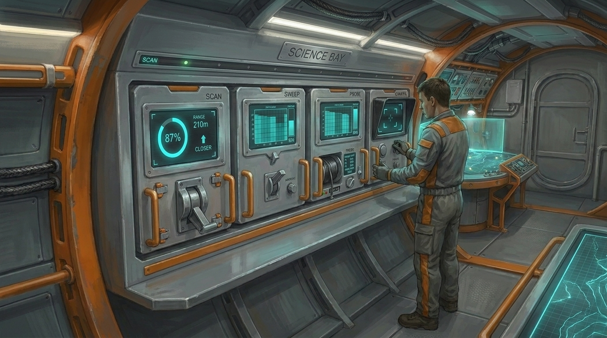

# Science station: concept

Concept record for the science station (also called the science bay): the sub's data-gathering station on
the starboard wall of midships, astern of the sonar station. Tracked in #529; its place in the layout in #586.
The locked art is `science_primary.png`.

## Locked (Tristan, 2026-11-26)

**A row of module bays.** Distinct, swappable instrument **modules**, each a bolt-in unit in its own
**bay**, with rails, quick-release latches, orange side handles and its own small screen, switch and
character. They sit **side by side in one row at chest height** over a sloped hand ledge, with a running
strip and a SCIENCE BAY plate above. Every module is readable and in reach at once.

- **Three bays.** It is hard to see a reasonable mission running more than three kinds of experiment, and
  with three a crew that targets certain missions doesn't have to keep swapping. The bay count is the limit
  that makes the loadout a choice.
- **Four module types,** so a fit is always three of four:
  - **SCAN:** a progress ring, range and a CLOSER hint; an arm switch.
  - **SWEEP** (bathymetry sounder): a coverage grid filling in along survey lines; an arm switch.
  - **PROBE:** a visible cable reel, a mechanical depth counter, and the sample-point list; a winch switch.
  - **CAMERA:** a hooded viewfinder screen, a light meter and a stillness indicator; a shutter.
- The crew chooses the modules **before a dive**, and the choice is physically visible in the bays.
  Choosing at the hub waits for the hub. The default fit is SCAN, SWEEP and CAMERA (a proposal; change it if
  wanted).
- `science_modules_reference.png` (round 1, variant 2) shows the modules themselves, larger. Its vertical
  stack is not the layout: the bottom bay sat at knee height, hard to read and work.

## Mechanics (see #529)

- One operator steps up to the station. **Mapped keys** select the active module (left/right) and work it
  (arm, shutter, aim).
- While a module runs, its screen shows how well it is going, how long is left, and what would make it
  better (for example "closer").
- Costs: SCAN is loud; SWEEP pings are loud and give the sub's position away; PROBE is quiet but slow and
  still; CAMERA needs the external lights or a flash, so it is bright.
- Power comes from the battery with no breaker for now. Breakers for the instruments are a follow-up (#585).
- A reading is done when it is complete and logged; the crew still has to get the sub home.

## Not chosen

- [Round 1, variant 1: tabbed screen](https://github.com/tsebens/silent_water/blob/d7968f1d2ed3ce677a986ea24e0982c6274630ca/concepts/science/science_var1.png?raw=true)
- [Round 1, variant 3: split-screen dashboard](https://github.com/tsebens/silent_water/blob/d7968f1d2ed3ce677a986ea24e0982c6274630ca/concepts/science/science_var3.png?raw=true)
- [Round 2, B: 2 x 2 grid](https://github.com/tsebens/silent_water/blob/2d90571f7e47454c853d301ab5a49a711111688f/concepts/science/science_r2_grid.png?raw=true)
