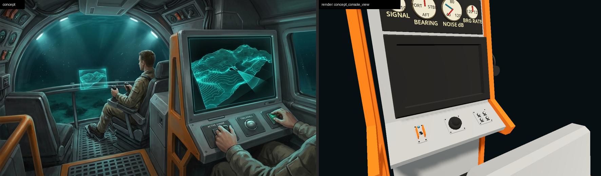
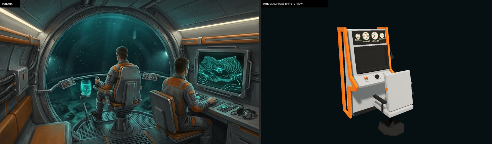
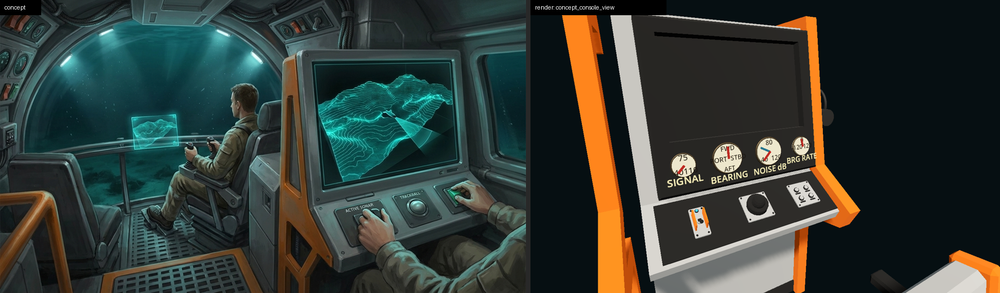
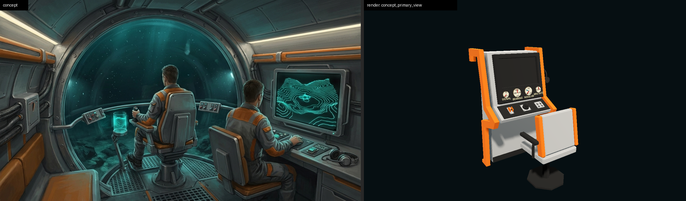
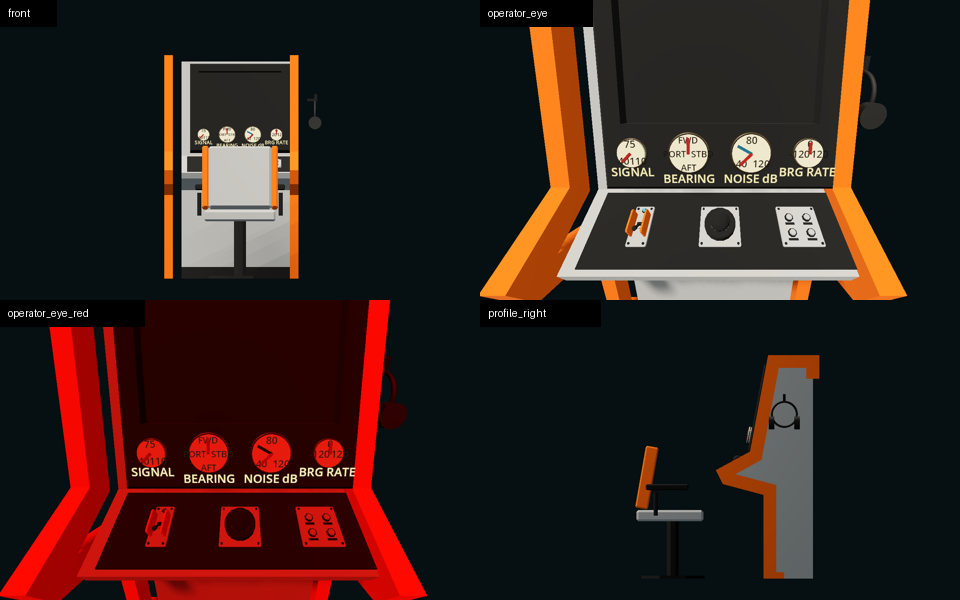

# Sonar console: concept review

Renders from `cameras.json` beside the concept images, judged only on the brief's `compare_on` list. Control count,
type and labels are ignored: the functional spec decides those. Each finding is routed to the scene that owns it.
Rounds are capped at two.

## Round 1

| # | Compare on | Finding | Owner | Action |
| --- | --- | --- | --- | --- |
| 1 | Massing | The dial header above the screen makes a tall arcade-cabinet silhouette; in the concept the screen bezel is the top of the console | `sonar_console` | Move the dials into the bezel's bottom border; lower the console top from 1.66 m to 1.52 m |
| 2 | Colour blocking | The orange reads as a thin outline round the whole side; the concept has a heavy member on the front edge | `sonar_console` | Front-edge and top frame only, wider and thicker |
| 3 | Control strip | Controls sit on a light strip; the concept's sit in dark pods | `sonar_console` | Dark inset panel under the controls |
| 4 | Seat | Tall plain back reads as an office chair; the concept's is shoulder height with orange bolsters | `operator_seat` | Lower the back to shoulder height, add orange bolsters |
| 5 | Colour blocking | The body reads near white; the concept's console is mid grey | style bible (`kit_palette.yaml`) | Not this asset's call: a palette decision (see the spike findings) |
| 6 | Massing | The dials read as cream-faced, brass-rimmed antiques, which the art direction rejects | `gauge` (game code) | Discovered work |
| — | Ignored | The concept has no dials; the render has four | — | Functional spec wins; only their placement was judged (finding 1) |
| — | Matches | Screen about 55 cm wide in a deep bezel; strip under the screen; toggle left, trackball centre, keys right | — | — |

## Round 2

Findings 1 to 4 resolved. Remaining differences, accepted or routed:

| # | Finding | Owner | Status |
| --- | --- | --- | --- |
| 5 | Body lighter than the concept's grey | style bible | Routed (decision) |
| 6 | Antique-looking dials | `gauge` | Routed (discovered work) |
| 7 | The bezel is black; the concept's is mid grey with a black screen | `sonar_console` | Accepted: the palette has no second grey (depends on 5) |
| 8 | The chart is square in a 16:10 opening | `flat_chart` | Routed (discovered work, from the breakdown) |
