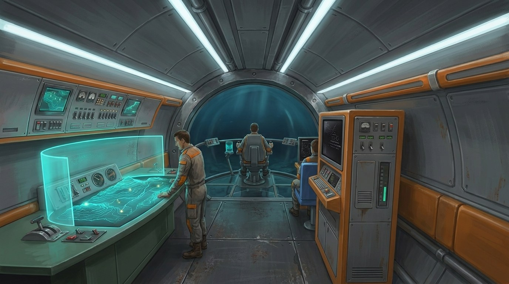
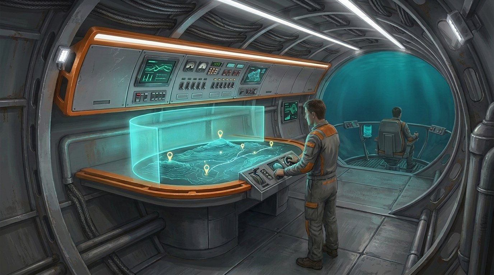
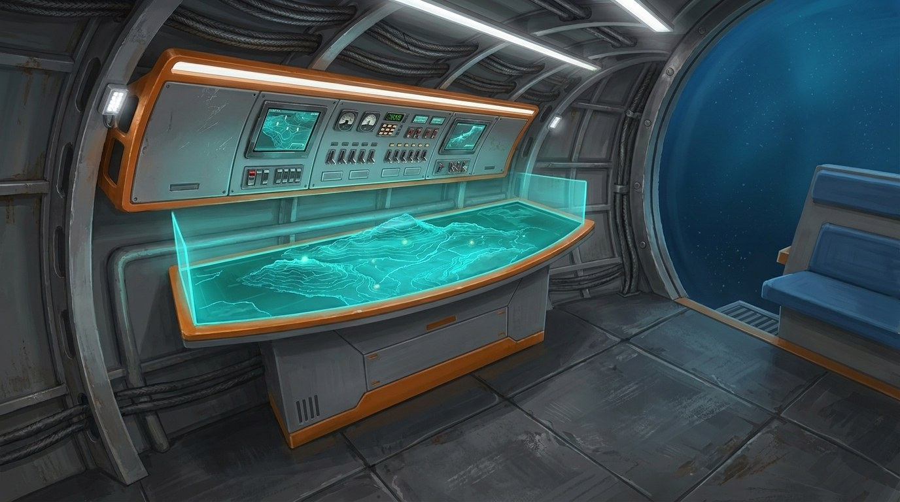
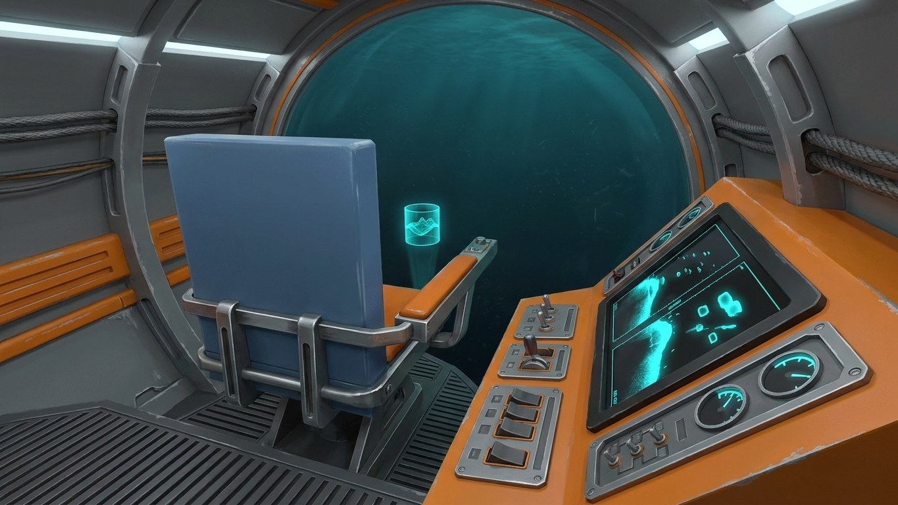
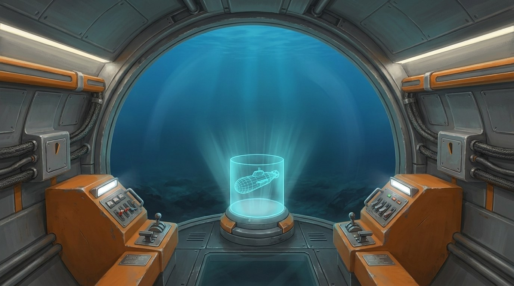
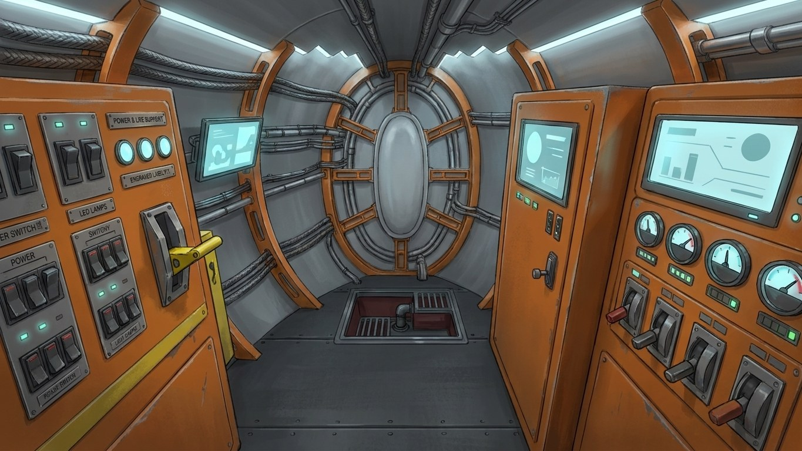

# Sub interior: paint-over concepts, round 2

Concept art painted over the greybox blockout (`../renders/blockout/`). Each shot keeps the blockout's camera,
so a later build can be rendered from the same camera and compared side by side. Not locked yet.

**How they were made:**
- Model: the asset pipeline's `google-pro` image provider (Gemini 3 Pro Image).
- Script: `../paintover.py`, which holds the prompts.
- Inputs: the blockout render, plus the locked cockpit and map table concepts as style anchors.
- Two variants per shot. The one kept is listed below.
- Round 1 (no fixes yet) taught three things:
  - the stern needed a cap, because the open end read as a window
  - the table had to be D-shaped
  - the prompt had to forbid invented furniture and digit readouts

This is a stopgap: Asset Studio can't paint over a scene shot yet (#333).

| Shot | Concept | What to take from it |
| --- | --- | --- |
| Midships forward (hero) |  | The shared volume: table with standing operator, sonar, countermeasures cabinet, pilot in the dome |
| Map operator (standing) |  | The D-shaped table, curved slab, cowl and edge console from the standing eye; the dome beyond |
| Map observer |  | The table in its bay from across the aisle |
| Sonar |  | Raked console on the right, pilot's seat back and mini hologram a metre ahead |
| Pilot |  | Armrest consoles, joysticks, the small sub-centred hologram low on the centreline |
| Engineering aft |  | Tight orange utility panels, drop-weight lever, bilge well with its pump |

## Known drift

What round 3 (or the build) should correct:

- **The dome** reads as a flat round window in a ring. The design is an unbroken hemisphere bulging forward of the ring, with the pilot's floor one step down and partly glass. The blockout hides the dome glass in eye-level shots, so the model has no shape to keep; a faint dome outline in the render would help.
- **Engineering's stern cap** still becomes a hatch-like oval. Shading the cap like the shell, or putting equipment on it, would stop that.
- **Leftovers:** a few round analogue gauges, and a little rust in the hero shot, which goes against "Modern, not antiquated".
- **Small details:**
  - The pilot's hologram holds a WW2-style submarine model.
  - The sonar screen sits flat on the desk in places, where the concept has it raked.
