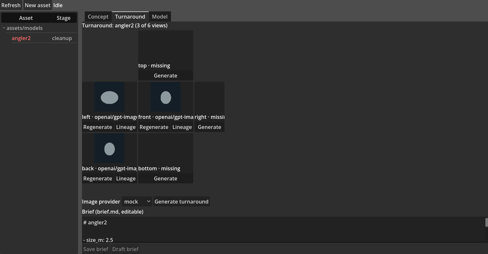
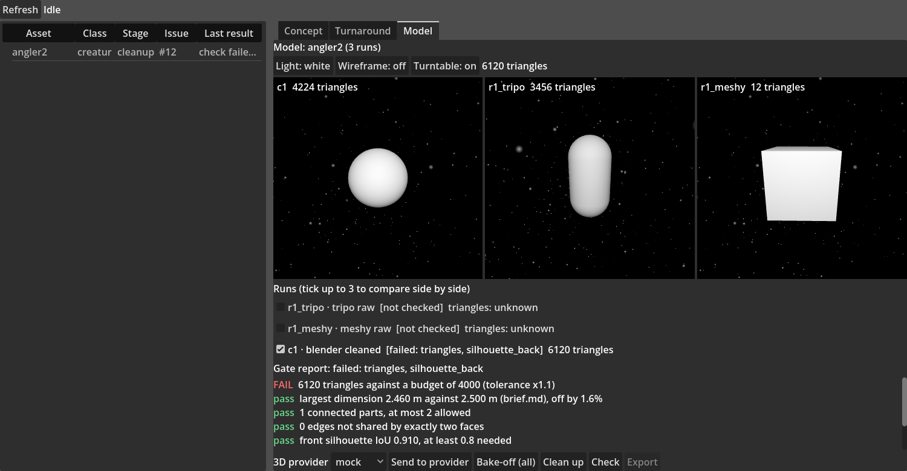

# Asset pipeline: Godot side

This covers Asset Studio: the image-to-3D route for organic assets, and the Onshape import for hand-modelled kit parts. Generated mechanical assets (controls, panels, stations) are built with cadkit instead: see [`asset_process.md`](asset_process.md).

Backend usage is in [`tools/asset_pipeline/README.md`](../tools/asset_pipeline/README.md). This covers what Godot and the repo checks do with an asset.

## Vertex colours

Cleaned meshes carry a small vertex-colour palette. Godot imports glTF vertex colours but does not apply them to albedo by default. Every asset GLB therefore uses the shared post-import script `res://assets/import/vertex_color_import.gd`, which sets `vertex_color_use_as_albedo` on every material (and gives material-less surfaces one). `asset export` writes `<slug>.glb.import` selecting it (`import_script/path`); Godot fills in the remaining import settings on first import.

### Palette snap (image-to-3D route)

For the image-to-3D classes (creature, prop, terrain), the `vertex_colour_palette` cleanup step snaps the vertex colours to the palette (`docs/palette.md`). It clusters the baked colours into at most `palette_size` colours, snaps each cluster to the nearest swatch among the environment (`env_*`), sea floor (`floor_*`), life (`life_*`) and flora (`flora_*`) swatches (by distance in linear RGB), and paints each face with its cluster's swatch. The swatch values are read from `assets/palette/palette.tres` when `asset cleanup` runs and passed to Blender as `swatches`, so a tuned swatch snaps, and bakes, its new value on the next cleanup. Every vertex colour in the result is then a swatch value (stored linear, as glTF expects). The swatches used are recorded in the cleanup record's `result.steps.vertex_colour_palette.swatches_used`, so the lineage says which swatches an asset depends on.

The colours are baked into the mesh, so no role is involved: editing a swatch does not change an already-cleaned asset until it is cleaned again. Making swatch edits reach these assets live would need roles for them (open question). Classes on other routes (architecture, interior) keep the plain k-means palette.

## `asset godot-check <slug>`

Copies the cleaned GLB to `build/asset_check/<slug>/` (git-ignored), imports it headless, and checks that every surface has `vertex_color_use_as_albedo`. It then renders three shots into the log dir (`$LOG_DIR`, `--log-dir`, else `./logs`): `<slug>_fog.png` (fog and ambient only), `<slug>_white.png` and `<slug>_red.png` (white and red light). Rendering needs a real display server; without `DISPLAY` it runs under `xvfb-run` when installed. `--no-render` skips the shots. The result is recorded in the manifest (`godot_checks`).

## `asset export <slug>`

Needs a mesh that passed `asset check`. Writes to `assets/models/<slug>/`: `<slug>.glb`, `<slug>.glb.import`, `<slug>.tscn` (an instance of the GLB), `concept/` (locked concept as `locked.<ext>`, the turnaround views and `brief.md`, with a `.gdignore`; PNGs over 2048 px are shrunk, other formats over 2048 px are an error) and `asset.yaml`.

## Kit parts: `asset import <slug> <export.gltf>`

The `kit` class (build route `cad`) is for the sub's controls, which Tristan models in Onshape instead of generating (conventions: `assets/media/kit/README.md`). It has no concept, turnaround or to3d stage: those commands refuse a kit asset. The class profile has a triangle budget of about 1,500, a scale range of 0.01–0.3 m and no silhouette gate.

`asset import <slug> <export.gltf> [--pivot <part name>] [--axis x|y|z] [--limits MIN MAX] [--control switch_lever|none] [--folder A/B]`:

- creates the asset (class `kit`, folder `kit`) when the slug is new;
- copies the export to `assets/media/kit/<slug>/<slug>.gltf` and runs the converter, `tools/asset_pipeline/asset_pipeline/blender/onshape_import_bpy.py`, in headless Blender (native or Docker, the same runner as `cleanup`). The origin goes to the centre of the back face, and the moving part goes under a `Pivot` node on its hinge with identity rotation;
- snaps each material to the nearest palette role (`docs/palette.md`: the colour a role shows is its glow swatch, else its surface swatch, read from `assets/palette/`), by the RGB value in the Onshape material name, and names it by the role, writing no colour; the post-import script applies the shared role material, and materials that snap to one role merge;
- records a `mesh` lineage entry (`i1`, `i2`, …, provider `onshape`) whose `source` holds the export's path and SHA-256, plus an `imports` record (parts, triangles, size, materials, how Blender ran). A re-import adds a new entry;
- records the moving part in the manifest's `pivots`: part name, axis, limits in degrees (default -40 40) and control. A `--pivot` that names no part of the export is an error that lists the parts.

`check` and `godot-check` then work on the latest import, and `check` reads the size from the import and skips the silhouette gates. The first toggle has 4,606 triangles against the 1,500 budget, so `check` fails its `triangles` gate until the part is simplified or checked with `--triangle-budget`. `export` writes `assets/models/<folder>/<slug>/<slug>.glb`, its `.glb.import` (kept if present) and `<slug>.tscn`: the model, a `SwitchLever` with `swing_deg` (the span of the limits) and `pivot` set from the manifest, and a grab box on collision layer 2 sized to the part. Other control scripts are separate work. The Studio's Model tab has an **Import CAD…** button (kit class): it opens a file dialog for the glTF export, with a field for the pivot part name, and runs this command. For `kit` assets the Studio hides the Concept and Turnaround tabs and the 3D-provider controls.

## Folders and moves

Assets can live in nested folders under `assets/models/`, e.g. `assets/models/organic/fauna/apex/asset.yaml`. An asset is found by searching `assets/models/**/<slug>/asset.yaml`, so flat `assets/models/<slug>/` assets keep working with no migration. Slugs are unique repo-wide (`asset new` refuses a slug that exists in any folder) and `.asset_work/<slug>/` stays flat. Folder segments use lowercase letters, digits, `_` and `-`. `asset list` reports each asset's `folder` and every `folders` entry, empty ones included. Git does not track an empty folder, so one made with `folder create` lasts only until the checkout is cleaned or recloned.

- `asset new <slug> --class C --folder a/b`: create the asset in a folder (made if missing).
- `asset move <slug> --to a/b`: move an asset (`--to ""` is the root).
- `asset folder create <a/b>`, `asset folder move <a/b> --to c`, `asset folder rename <a/b> <name>`.

A move rewrites every repo path recorded inside the moved assets: the manifest, the `checks/*.json` reports, and the `res://assets/models/...` references in the exported `.tscn` and `.glb.import`. Paths stay POSIX. Illegal requests are errors and change nothing: a destination that exists, is inside an asset, or is the folder itself or one of its descendants; creating a folder that already exists, hides an asset or nests inside one.

## Rename, delete and trash

- `asset rename <slug> <new_slug>`: renames in place (same parent folder). Moves the asset folder and `.asset_work/<slug>/`, sets the manifest `slug`, rewrites every stored repo path (POSIX) in the manifest, the check reports and the exported files, and renames `<slug>.glb`, `<slug>.glb.import` and `<slug>.tscn` with their `res://` references and the scene's root node name. The new slug follows the `asset new` rules and must be unused repo-wide. The manifest gets a `renames` entry (old, new, timestamp); lineage ids, the cost ledger and reviewer decisions are untouched.
- `asset delete <slug>`: moves the asset folder and `.asset_work/<slug>/` to `.asset_work/_trash/<slug>-<timestamp>/` (`asset/`, `work/`, `meta.json`). `asset folder delete <path>` removes an empty folder, or trashes every asset it holds and then removes the folder.
- `asset trash list`, `asset trash restore <entry>` (back to its original folder; refused if the slug has been reused) and `asset trash empty` (permanent).
- `asset summary <slug>`: class, stage, variant / turnaround view / mesh counts, ledger cost and which exported files exist; also returned by rename and delete. The plugin uses it for confirmation dialogs.

Rename and delete are refused while another backend command is running on the asset (each command on a slug holds a lock file in `.asset_work/_locks/`; locks of dead processes are ignored). All of this changes the working tree only: nothing is committed, so review `git status` and commit (or discard) the result yourself. `.asset_work/` is git-ignored, so trashed work files are not in git.

## CLI progress

**Reference images.** `asset concept <slug> --reference <image> [--reference …] [--mode paint-over|inspire]` hands your own images (a blockout render, a sketch; PNG, JPEG or WebP) to the image model with the style anchors. Paint-over (the default) keeps the reference's composition, camera, proportions and major shapes and restyles it, using the provider's edit path; inspire treats it as a loose starting point. References are copied, converted to PNG and scaled to the provider's input limit under `.asset_work/<slug>/references/`. With several references, `--n` variants are made per reference. Each variant's lineage records `reference: {name, sha256}` (original file name and content hash, never a path) and `mode`; `refine` of a paint-over variant re-passes the same reference. `--estimate` and the cost ledger count one generation per variant.

**Presentation.** `asset concept <slug> --presentation subject|scene` (default `subject`). `subject` is the single-asset look for image-to-3D: one subject, centred, on a plain neutral dark-grey background, flat frontal light, no people. `scene` is for interiors and environment shots: the global presentation paragraph in `style.md` and the shared list in `negative.md` are swapped for the `## presentation_scene` section of each file. The scene rules keep the reference's camera, perspective and framing, put the full environment in frame, allow in-world light (cove lights, screens, holograms) but no bloom or lens effects, and allow people when the brief asks. A class may set `concept_presentation: scene` in `classes.yaml`; it applies when the flag is absent, and an explicit flag overrides it. Each concept variant's lineage records `presentation`, and `refine` inherits its variant's presentation (a variant from before the field counts as `subject`). `subject` prompts are byte-for-byte what they were before the flag existed. The `interior` class (the sub's inside, styled from the art direction's "The sub" and "Modern, not antiquated" sections) has build route `scripted` and defaults to `scene`. The Studio's Subject / Scene toggle is a separate arc.

**Reference picker (Asset Studio, Concept tab).** *Add reference…* opens a file dialog for any PNG, JPEG or WebP on disk. Chosen references show as thumbnails with *Remove* buttons, and a Paint-over / Inspire toggle appears beside them. *Generate more* then passes `--reference` (once per image) and `--mode`; the picker clears when another asset is selected. Each variant card shows a small thumbnail of its reference (the stored copy under `.asset_work/<slug>/references/`, found from the lineage `sha256`), and the Lineage panel shows the reference and its mode. *Refine* does not use the picker: the backend re-passes the variant's own reference.

`concept`, `turnaround`, `brief`, `to3d`, `cleanup` and `godot-check` print short progress lines to **stderr** (`writing prompts (claude-cli)…`, `image 2/3 (google)…`). stdout stays one JSON object, so the plugin can parse it and show the latest stderr line in its status bar.

## Cost ledger

The manifest's append-only `costs` list records every paid backend call (units, USD, basis, the unit price used); prices live in `tools/asset_pipeline/prices.yaml`. Image, prompt-writer and 3D (`to3d`, one entry per bake-off provider) calls are all recorded. `to3d` takes `--views` and repeatable `--option key=value`, and prices by option (TRELLIS.2 resolution); see the backend README. `asset cost <slug>` and `asset cost --all` summarise it, `--estimate` on a paid command prices it without calling anything, and an optional soft `budget_usd` (per class in `classes.yaml`, overridable in the manifest) makes `asset cost` warn without blocking. The Asset Studio plugin shows it: a Cost column in the Queue, a per-stage and per-provider cost panel (estimated figures marked "~", budget warning), and an estimate on each paid action button taken from `--estimate`. `list` carries each asset's effective `budget_usd` for this. See the backend README for the entry fields and bases.

## Repo gates (`tools/check.sh`)

- `asset_sizes`: fails on any file over 5 MB under `assets/` (`tools/check_asset_sizes.py`). Files already committed over the limit are listed in `tools/asset_size_allowlist.txt`; do not add to it.
- `export_presets`: if `export_presets.cfg` exists, every preset's `exclude_filter` must exclude `addons/asset_studio/*` and `tools/*` (`tools/check_export_presets.py`). Passes when there is no presets file. When creating presets, set `exclude_filter="addons/asset_studio/*, tools/*"` so the plugin and backend never ship with the game.

## Asset Studio plugin (`addons/asset_studio/`)

Enabled in `project.godot`; adds an **Asset Studio** tab next to 2D / 3D / Script. It never calls a service: every action runs `asset <command>` (default `uv run --project tools/asset_pipeline asset …`) on a worker thread, with a status line and progress bar, so the editor does not freeze. A backend error is shown verbatim in red at the bottom; non-JSON output (a traceback, a missing `uv`) is shown as printed.

- **Queue** (left): a collapsible folder tree mirroring `assets/models/`; rows show name and stage only (class, issue, cost and last result are in the row tooltip and the selected asset's header). The splitter is draggable and its position is remembered (`user://asset_studio.cfg`). Drag an asset onto a folder to move it, or a folder into another to nest it; right-click a folder for New asset here, New folder, Rename and Delete…, or an asset for Rename… and Delete…. Rename validates the slug live with the New asset rules and keeps the renamed asset selected; Delete asks for confirmation with class, stage, variant / view / mesh counts, cost and exported files (a folder lists the assets it holds), then runs `asset delete` / `asset folder delete`. Menu items are disabled while a backend command runs. Every move is a backend command (`move <slug> --to`, `folder create|move|rename`, `new --folder`) followed by a refresh; the plugin never moves files. New asset uses the selected folder, else the selected asset's folder, else the root. It reads `asset list`, whose assets may carry a `folder` and whose output may carry a `folders` array (so empty folders show). The status bar shows the latest stderr line of a running command. GDScript has no YAML reader, so the plugin reads `asset list`, which prints every manifest as JSON along with the configured provider names.
- **Remembered choices.** Each provider or writer dropdown (Concept image provider and prompt writer, Turnaround image provider, Model 3D provider) keeps the value last chosen, per dropdown and per machine, in `EditorSettings.set_project_metadata` (never in committed config). It survives an action and its refresh, switching assets and an editor restart. With nothing remembered, or a remembered value no longer configured, the dropdown shows the effective selection from `asset list` (`providers.local.yaml`, then `providers.yaml`). When that effective choice is `mock` while a real provider of that kind has its key set (process environment or `tools/asset_pipeline/.env`), the entry reads "mock (no cost, placeholder output)"; commands still receive the plain name.
- **Concept** (right): a grid of variants with prompt and provider; per variant Approve (`lock`), Reject (`lock --decision rejected`), Refine with the notes box (`concept --refine … --notes …`) and Lineage; "Generate more" with an image-provider dropdown; a lineage panel (prompt, model, parent for each ancestor).
- **Turnaround** (tab): the views of the latest turnaround set as a 3×3 cross around the front view (top above; left, front, right in the middle row; back bottom-left and bottom below front). Each cell has its label, Regenerate (`turnaround --view <v>`) and Lineage; a view not generated, such as top and bottom on a four-view asset, is a labelled empty slot with a Generate button (the same `--view` call). The grid scales to fit the tab at a fixed aspect ratio (`AssetTurnaroundModel.fit_cell_size`), the tab scrolls as a fallback, and clicking a view opens it larger in an overlay. Also "Generate turnaround" with an image-provider dropdown. Below, the asset's `brief.md` in an editable box: Save writes the file directly (no service call); "Draft brief" (`brief`) needs the four core views (front, left, back, right) and is refused while there are unsaved edits, because the backend overwrites the file.
- **Model** (tab): a SubViewport preview per ticked run (up to three side by side, for the bake-off) lit like the game: its dark ambient, fog values copied from `game.tscn`, and the marine snow shader. Buttons: white/red light, wireframe, turntable. Each preview shows its triangle count; below are the runs (raw provider meshes and cleaned meshes) with their gate summary, the gate report of the first ticked run (pass/FAIL per gate, with the numbers) and buttons for `to3d` (one provider, or all for the bake-off), `cleanup`, `check` and `export`. Export is enabled only for a cleaned mesh whose gates passed. Raw meshes load from `.asset_work/` at runtime; a run with no file on disk shows an empty preview. Next to the 3D provider dropdown, thumbnails of the asset's turnaround views are the **view picker**: a single-image provider (`max_views` 1) gets a radio choice of one view, any other an ordered multi-select up to its limit (the order picked is the order sent). The pick is remembered per asset (like the other remembered choices) and sent as `--views`; with nothing picked, `to3d` uses each provider's default views, so the bake-off does too. A bake-off with a pick shares one `--views`, cut to the smallest limit among its providers so the call is not refused. The limits come from `asset list`'s `three_d_max_views`.
- Code: view models `queue_model.gd`, `new_asset_model.gd` (the New asset dialog: slug rules and the `new` call), `concept_model.gd` (also the description and the `describe` call), `turnaround_model.gd`, `model_model.gd` (light, wireframe and turntable state live here) and `backend_result.gd` hold the logic and are unit-tested from `tests/fixtures/asset_studio/` (`tests/unit/test_asset_studio.gd`); `studio_panel.gd` is the UI, `model_preview.gd` the SubViewport preview and `backend_runner.gd` the async runner.
- Screenshots with fixture data (`xvfb-run godot --path . res://tests/asset_studio_shot.tscn -- concept.png turnaround.png model.png`; the turnaround views and meshes in these are generated stand-ins).

Playtest-only: whether the preview lighting matches in-game feel.

Cleanup runs Blender natively or in Docker, chosen by `ASSET_BLENDER_RUNNER=native|docker|auto` (default `auto`: a local Blender wins, else Docker). The image `silent-water/blender-cleanup:<version>` (override with `ASSET_BLENDER_IMAGE`; about 1 GB) is built with `uv run asset blender-image build`. Details are in `tools/asset_pipeline/README.md`. CI covers both runners: the `check` job runs the native one, the `docker-cleanup` job the Docker one.
