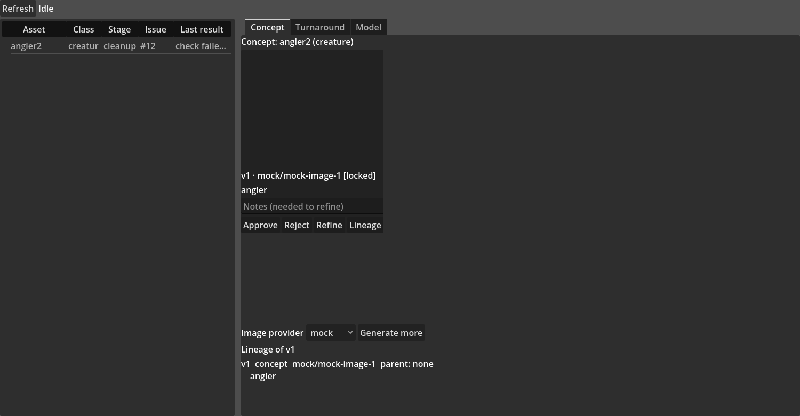

# Asset pipeline: Godot side

Backend usage is in [`tools/asset_pipeline/README.md`](../tools/asset_pipeline/README.md). This covers what Godot and the repo checks do with an asset.

## Vertex colours

Cleaned meshes carry a small vertex-colour palette. Godot imports glTF vertex colours but does not apply them to albedo by default. Every asset GLB therefore uses the shared post-import script `res://assets/import/vertex_color_import.gd`, which sets `vertex_color_use_as_albedo` on every material (and gives material-less surfaces one). `asset export` writes `<slug>.glb.import` selecting it (`import_script/path`); Godot fills in the remaining import settings on first import.

## `asset godot-check <slug>`

Copies the cleaned GLB to `build/asset_check/<slug>/` (git-ignored), imports it headless, and checks that every surface has `vertex_color_use_as_albedo`. It then renders three shots into the log dir (`$LOG_DIR`, `--log-dir`, else `./logs`): `<slug>_fog.png` (fog and ambient only), `<slug>_white.png` and `<slug>_red.png` (white and red light). Rendering needs a real display server; without `DISPLAY` it runs under `xvfb-run` when installed. `--no-render` skips the shots. The result is recorded in the manifest (`godot_checks`).

## `asset export <slug>`

Needs a mesh that passed `asset check`. Writes to `assets/models/<slug>/`: `<slug>.glb`, `<slug>.glb.import`, `<slug>.tscn` (an instance of the GLB), `concept/` (locked concept as `locked.<ext>`, the turnaround views and `brief.md`, with a `.gdignore`; PNGs over 2048 px are shrunk, other formats over 2048 px are an error) and `asset.yaml`.

## Repo gates (`tools/check.sh`)

- `asset_sizes`: fails on any file over 5 MB under `assets/` (`tools/check_asset_sizes.py`). Files already committed over the limit are listed in `tools/asset_size_allowlist.txt`; do not add to it.
- `export_presets`: if `export_presets.cfg` exists, every preset's `exclude_filter` must exclude `addons/asset_studio/*` and `tools/*` (`tools/check_export_presets.py`). Passes when there is no presets file. When creating presets, set `exclude_filter="addons/asset_studio/*, tools/*"` so the plugin and backend never ship with the game.

## Asset Studio plugin (`addons/asset_studio/`)

Enabled in `project.godot`; adds an **Asset Studio** tab next to 2D / 3D / Script. It never calls a service: every action runs `asset <command>` (default `uv run --project tools/asset_pipeline asset …`) on a worker thread, with a status line and progress bar, so the editor does not freeze. A backend error is shown verbatim in red at the bottom; non-JSON output (a traceback, a missing `uv`) is shown as printed.

- **Queue** (left): every manifest, with class, stage, linked issue and last result. GDScript has no YAML reader, so the plugin reads `asset list`, which prints every manifest as JSON along with the configured provider names.
- **Concept** (right): a grid of variants with prompt and provider; per variant Approve (`lock`), Reject (`lock --decision rejected`), Refine with the notes box (`concept --refine … --notes …`) and Lineage; "Generate more" with an image-provider dropdown; a lineage panel (prompt, model, parent for each ancestor).
- **Turnaround** (tab): the four views of the latest turnaround set side by side (front, left, back, right; a missing one is labelled), each with Regenerate (`turnaround --view <v>`), plus "Generate turnaround" with an image-provider dropdown. Below, the asset's `brief.md` in an editable box: Save writes the file directly (no service call); "Draft brief" (`brief`) needs all four views and is refused while there are unsaved edits, because the backend overwrites the file. The backend's `turnaround` does not take `--view` yet; until it does, per-view Regenerate shows the backend's error.
- **Model** (tab): a SubViewport preview per ticked run (up to three side by side, for the bake-off) lit like the game: its dark ambient, fog values copied from `game.tscn`, and the marine snow shader. Buttons: white/red light, wireframe, turntable. Each preview shows its triangle count; below are the runs (raw provider meshes and cleaned meshes) with their gate summary, the gate report of the first ticked run (pass/FAIL per gate, with the numbers) and buttons for `to3d` (one provider, or all for the bake-off), `cleanup`, `check` and `export`. Export is enabled only for a cleaned mesh whose gates passed. Raw meshes load from `.asset_work/` at runtime; a run with no file on disk shows an empty preview.
- Code: view models `queue_model.gd`, `concept_model.gd`, `turnaround_model.gd`, `model_model.gd` (light, wireframe and turntable state live here) and `backend_result.gd` hold the logic and are unit-tested from `tests/fixtures/asset_studio/` (`tests/unit/test_asset_studio.gd`); `studio_panel.gd` is the UI, `model_preview.gd` the SubViewport preview and `backend_runner.gd` the async runner.
- Screenshots with fixture data (`xvfb-run godot --path . res://tests/asset_studio_shot.tscn -- concept.png turnaround.png model.png`; the turnaround views and meshes in these are generated stand-ins).

Playtest-only: whether the preview lighting matches in-game feel.
