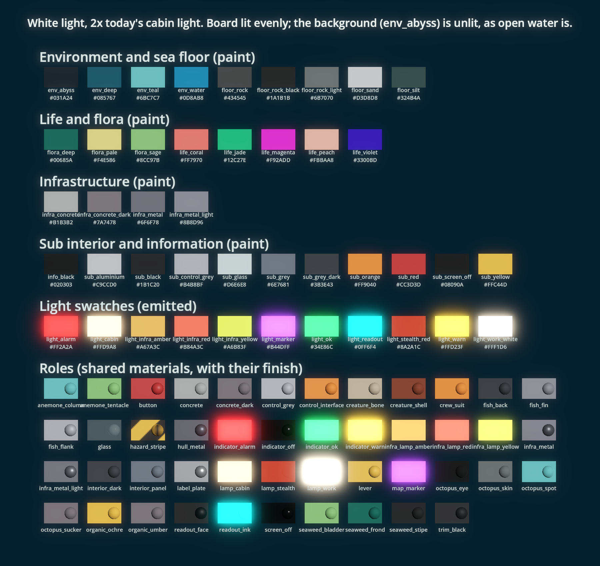
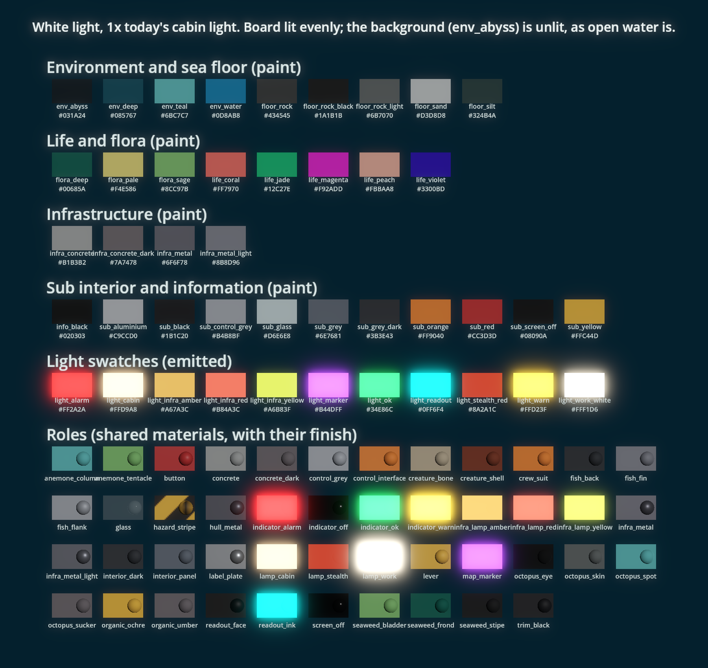
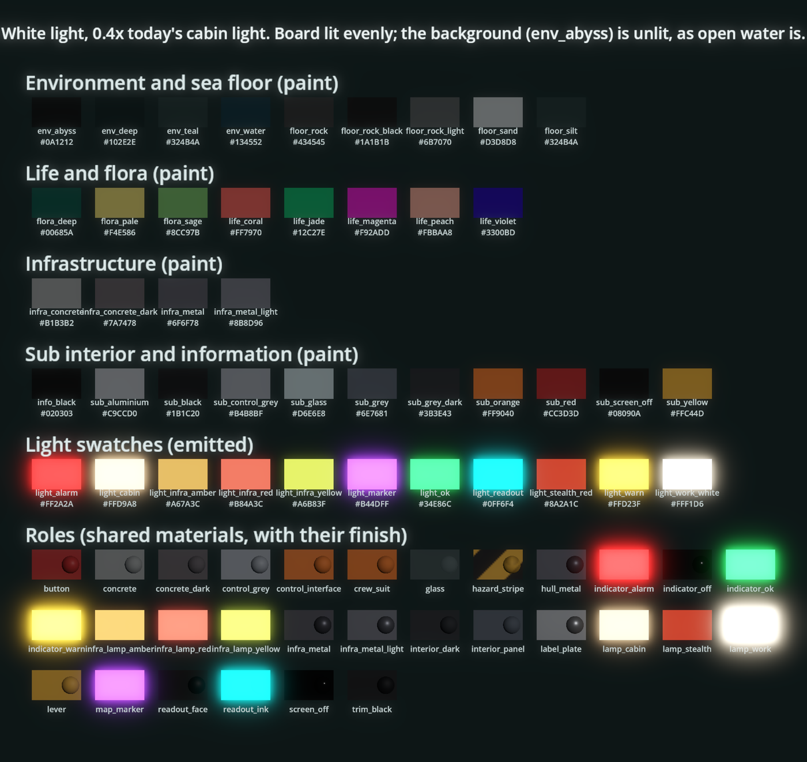
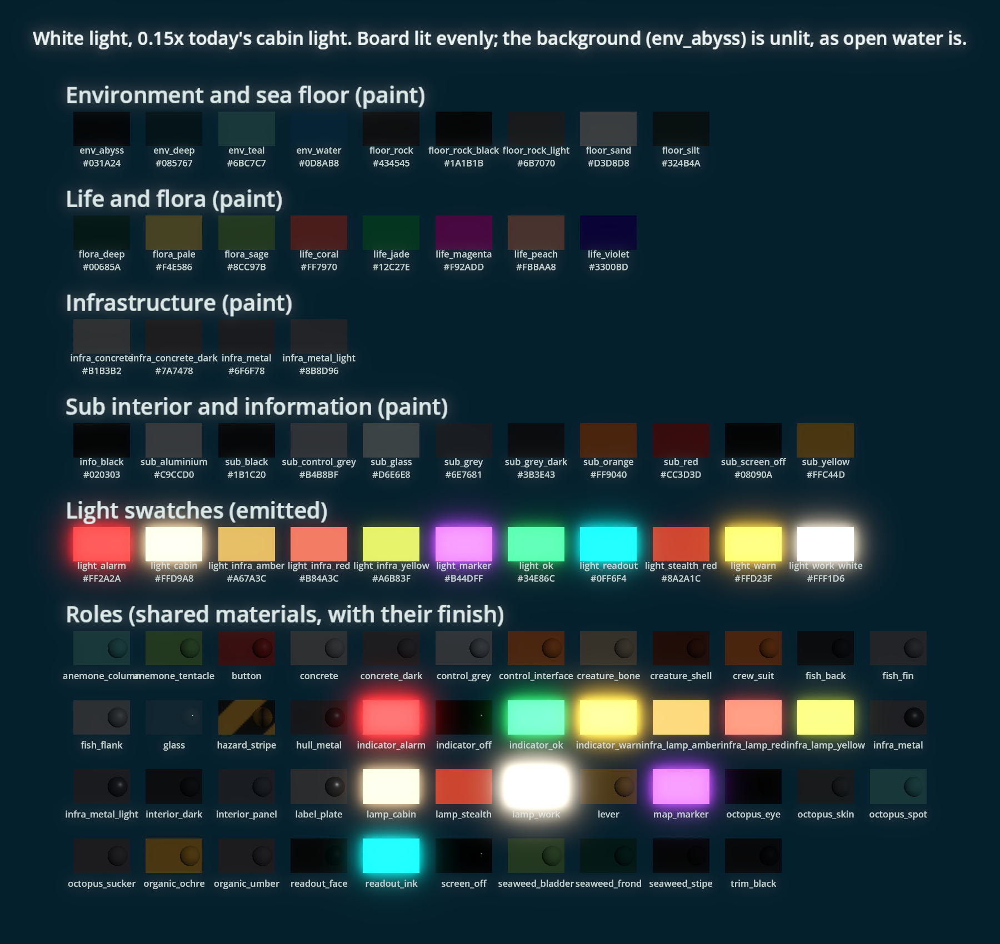
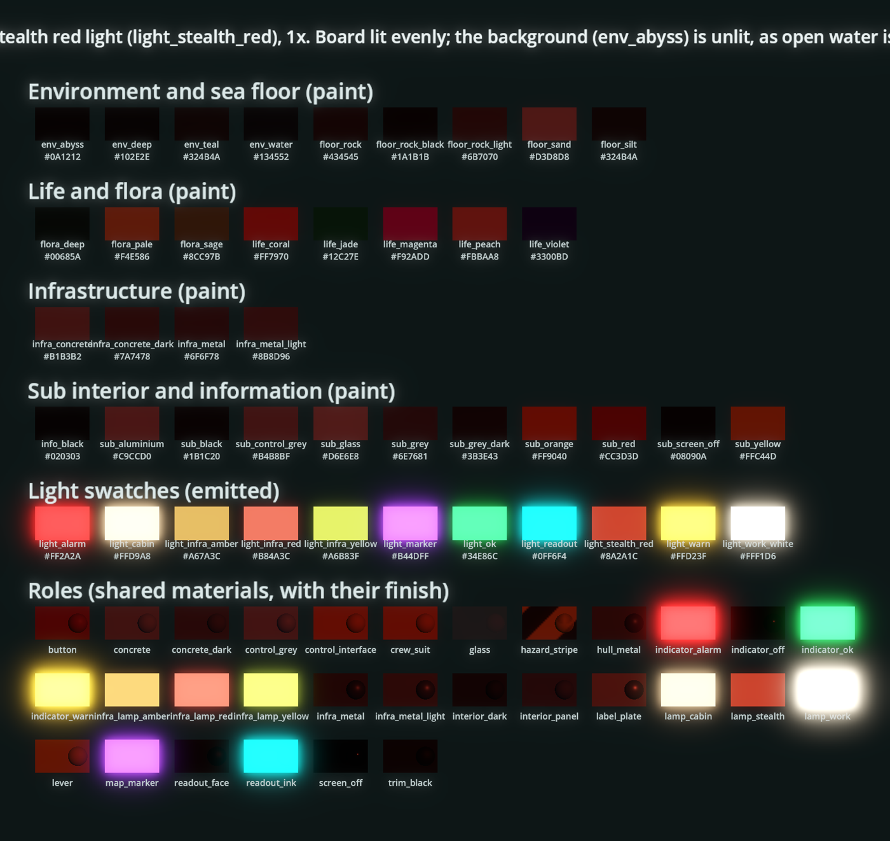

# Palette

The game's colours, and how they reach assets and code. Decided with Tristan on #348 (2026-11-25); the work is M13
(#358).

## How it is built: swatches, roles, assets

1. **Swatches** are named colours in one Godot resource, `assets/palette/palette.tres` (class `Palette`). Each is
   either **paint** (a surface colour) or **light** (a colour something emits). A light swatch's brightness comes
   from the energy it is used at, not from its value.
2. **Roles** are shared materials, one per job: `assets/palette/roles/<role>.tres` (class `RoleMaterial`, a
   StandardMaterial3D). A role names its swatches (`swatch` for the surface, `glow` for what it emits, `stripe` for a
   second stripe colour) and adds its finish (roughness, metal, transparency, emission energy). It stores no colour
   values, only swatch names.
3. **Assets name roles, never colours.** A generated mesh's surfaces are named after roles, and on import the shared
   post-import script gives each surface the shared role material. Code asks for a swatch by name:
   `Palette.main().color(&"light_readout")`.

**To change a shade,** edit one swatch: open `palette.tres` in the inspector, or call `Palette.main().set_color()`.
Every role that uses the swatch, and every asset with that role, follows at once, in the editor and in the game, with
no rebuild or re-import. **To change a rule** ("levers are yellow"), point the role at another swatch. **To add a
colour,** add a swatch, then a role if assets need it.

`uv run --project tools/cadkit cadkit palette` prints every swatch with its current value and every role with its
swatches. `cadkit palette --sheets` renders the swatch sheets below.

## Rules

- **Interaction is orange.** Control interfaces, the frames and guards around controls, lockers, weapons, crew suits
  and diver gear: anything that tells a player "you can use this".
- **Large levers are yellow.** Switches, selectors, knobs and trackballs are **light grey**, lighter than the hull
  metal. **Buttons are red.** Label plates are **aluminium**, with dark text. Hazard stripes are yellow and black.
- **Information is neon cyan on black:** readouts, charts, maps, gauge marks and needles. The band of bright,
  saturated cyan (hue 165 to 195 degrees, saturation and value above about half) is **reserved for information**.
  Nothing else may use it; a unit test checks the palette (`tests/unit/test_palette.gd`).
- **Two reds, two jobs.**
  - `light_stealth_red` is the stealth light: dim and rusty. It is gameplay (the design doc's red light).
  - `light_alarm` is emergency and alarm: bright. It is also the threat colour.
- **Indicator states** are green, yellow and red: `indicator_ok`, `indicator_warn`, `indicator_alarm`, and
  `indicator_off` for an unlit lens. **Sonar contacts** use the same three (#359): yellow unknown, green friendly or
  infrastructure, red threat.
- **Map markers and pins are neon purple** (`map_marker`): outside the indicator colours and clear on a black and cyan
  chart.
- **Infrastructure** is concrete and metal, lighter than real so it reads against the dark. Its lights are neon
  **amber, yellow and red**; blue and green would vanish against the water.
- **The sub's interior** is brighter on average than the world outside, so the two never blur together. Its light is
  dim and warm: bright enough to tell colours apart, only just.
- **Screens that are off** are near black. **Glass** is nearly clear, with a little rim light.
- **Light swatches are lights, everything else is paint.** Few things emit: lamps, readouts, markers, neon strips.

**Under red light, colour coding collapses** (see the stealth red sheet): orange, yellow, red and grey all read as the
same reds, while emitted colours still read. Controls must also be told apart by **shape and position**, never by paint
colour alone.

## Swatches

Values live in `palette.tres` and will be tuned; run `cadkit palette` for the current ones. Proposed values, for
Tristan to tune, are: `env_water`, `life_jade`, `infra_metal_light`, `sub_control_grey`, `sub_aluminium`, `sub_screen_off`, `sub_glass`, `info_black`, `light_marker`, `light_ok`, `light_warn`, `light_alarm`, `light_work_white`, `light_cabin`, `light_stealth_red`, `light_infra_red`.

| Paint swatch | What it is |
| --- | --- |
| `env_abyss` | Background: the darkest water, far fog |
| `env_deep` | Background: deep water; the ocean fog colour |
| `env_teal` | Background: lit water, near fog |
| `env_water` | Ocean water, before light sources modulate it |
| `floor_sand` | Sea floor: light sand |
| `floor_silt` | Sea floor: dark silt (same value as env_teal in the notes) |
| `floor_rock` | Sea floor: rock |
| `floor_rock_light` | Sea floor: weathered rock |
| `floor_rock_black` | Sea floor: dark rock |
| `life_violet` | Organic life: bright, cool, near neon |
| `life_magenta` | Organic life |
| `life_coral` | Organic life |
| `life_jade` | Organic life. Replaces #0EBAAA, which sat in the information band |
| `life_peach` | Organic life |
| `flora_deep` | Flora: muted deep green |
| `flora_sage` | Flora: muted sage |
| `flora_pale` | Flora: pale yellow |
| `infra_concrete` | Infrastructure concrete, lighter than real so it reads against the dark |
| `infra_concrete_dark` | Infrastructure concrete, weathered |
| `infra_metal` | Metal: infrastructure and the sub's hull |
| `infra_metal_light` | Metal, lighter. The notes listed #6F6F78 twice |
| `sub_orange` | Interaction: control interfaces, lockers, suits, anything a player can use |
| `sub_yellow` | Large levers; hazard stripes |
| `sub_red` | Buttons |
| `sub_grey` | Interior panels |
| `sub_grey_dark` | Interior: dark panels, recesses, control base plates |
| `sub_black` | Interior: trim, bezels, fixings; hazard stripes |
| `sub_control_grey` | Switches, selectors, knobs: lighter than the hull metal |
| `sub_aluminium` | Label plates: light, so dark text reads |
| `sub_screen_off` | A screen that is off: near black |
| `sub_glass` | Glass tint (used nearly transparent) |
| `info_black` | Behind readouts, charts and gauges |

| Light swatch | What it is |
| --- | --- |
| `light_readout` | Information: readouts, charts, gauge marks. The reserved cyan band |
| `light_marker` | Map markers and pins: neon purple, outside the indicator colours |
| `light_ok` | Indicator: on, safe, friendly contact |
| `light_warn` | Indicator: warning, unknown contact |
| `light_alarm` | Indicator and emergency: alarm, threat contact, emergency lights |
| `light_work_white` | External work lights: halogen white |
| `light_cabin` | Cabin light: dim warm white, bright enough to tell colours apart |
| `light_stealth_red` | Stealth light: dim, rusty red. Not the alarm red |
| `light_infra_amber` | Infrastructure neon: amber |
| `light_infra_yellow` | Infrastructure neon: yellow |
| `light_infra_red` | Infrastructure neon: red. The notes listed #A67A3C twice |

## Roles

**Sub interior**

| Role | Swatches | For |
| --- | --- | --- |
| `hull_metal` | `infra_metal` | The sub's bare metal, inside and out |
| `interior_panel` | `sub_grey` | Painted interior panels, console bodies, seats |
| `interior_dark` | `sub_grey_dark` | Dark panels, recesses, control base plates |
| `trim_black` | `sub_black` | Trim, bezels, bolts, rings, fixings |
| `control_interface` | `sub_orange` | Interaction: frames around controls, guards, lockers, anything a player can use |
| `lever` | `sub_yellow` | Large levers |
| `button` | `sub_red` | Buttons |
| `control_grey` | `sub_control_grey` | Switches, selectors, knobs, trackballs |
| `label_plate` | `sub_aluminium` | Label plates (dark text on them) |
| `hazard_stripe` | `sub_yellow`, stripes `sub_black` | Yellow and black hazard stripes |
| `crew_suit` | `sub_orange` | Crew suits and diver gear |
| `screen_off` | `sub_screen_off` | A screen that is off |
| `glass` | `sub_glass` | Glass: nearly clear, a little rim light |

**Information and indicators**

| Role | Swatches | For |
| --- | --- | --- |
| `readout_face` | `info_black` | Behind readouts: gauge faces, chart backgrounds |
| `readout_ink` | `info_black`, glows `light_readout` | Readout marks, needles, chart lines: glowing cyan |
| `map_marker` | `info_black`, glows `light_marker` | Map markers and pins |
| `indicator_off` | `sub_screen_off` | An indicator lamp's lens when it is off |
| `indicator_ok` | `info_black`, glows `light_ok` | Indicator lamp: on, safe, friendly |
| `indicator_warn` | `info_black`, glows `light_warn` | Indicator lamp: warning, unknown |
| `indicator_alarm` | `info_black`, glows `light_alarm` | Indicator lamp: alarm, threat; emergency lights |

**Light fixtures**

| Role | Swatches | For |
| --- | --- | --- |
| `lamp_work` | `info_black`, glows `light_work_white` | The face of an external work light |
| `lamp_cabin` | `info_black`, glows `light_cabin` | The face of a cabin light |
| `lamp_stealth` | `info_black`, glows `light_stealth_red` | The face of a stealth (red) light |
| `infra_lamp_amber` | `info_black`, glows `light_infra_amber` | Infrastructure neon strip: amber |
| `infra_lamp_yellow` | `info_black`, glows `light_infra_yellow` | Infrastructure neon strip: yellow |
| `infra_lamp_red` | `info_black`, glows `light_infra_red` | Infrastructure neon strip: red |

**Infrastructure**

| Role | Swatches | For |
| --- | --- | --- |
| `concrete` | `infra_concrete` | Infrastructure concrete |
| `concrete_dark` | `infra_concrete_dark` | Infrastructure concrete, weathered |
| `infra_metal` | `infra_metal` | Infrastructure metal |
| `infra_metal_light` | `infra_metal_light` | Infrastructure metal, lighter |

**Organics**

| Role | Swatches | For |
| --- | --- | --- |
| `anemone_column` | `env_teal` | The sea anemone's column, base and oral disc |
| `anemone_tentacle` | `flora_sage` | The sea anemone's tentacles (the nearest existing pale teal) |

**Life**

| Role | Swatches | For |
| --- | --- | --- |
| `octopus_skin` | `floor_rock_light` | Octopus arm skin |
| `octopus_sucker` | `infra_concrete_dark` | Octopus arm suckers |
| `octopus_spot` | `env_teal` | Octopus small flat teal spots on mantle and arms |
| `octopus_eye` | `info_black` | Octopus pupil slits |

Environment, sea floor, life and flora have swatches but, apart from the roles above, no roles yet: those assets come from the image-to-3D route

with vertex colours. Moving them onto the palette is part of the migration (M13).

## Swatch sheets

Every swatch and role on a board, against the darkest background colour, under five lights. "1x" lights the board as
evenly as one of today's cabin lights lights a surface 1.5 m away. Regenerate with `cadkit palette --sheets`.

| Light | Sheet |
| --- | --- |
| White, 2x |  |
| White, 1x |  |
| White, 0.4x |  |
| White, 0.15x |  |
| Stealth red, 1x |  |

## No colour literals in code

`tests/unit/test_no_colour_literals.gd` scans `src/` and fails on `Color(<number or string>)`, `Color8(...)`,
`Color.from_*` and any named colour other than `Color.WHITE`, `Color.BLACK` and `Color.TRANSPARENT` (neutrals). Wrapping
a swatch is fine: `Color(Palette.main().color(&"light_alarm"), 0.6)`. Allowed to hold values: `src/palette/`,
`src/debug/`, `src/lab/` and `src/ui/reticle.gd`. A single line can opt out with a `# palette-ok: <reason>` comment;
use it only for colours that are generated, not chosen (for example a hue per peer id).

## Still to move onto the palette

- The game's hard-coded colours: the world, creatures and objectives are done (M13.6); still to go are the gauges,
  the chart screen, the holographic maps and the debug overlay.
- The image-to-3D route's vertex-colour palettes (creatures, terrain).
