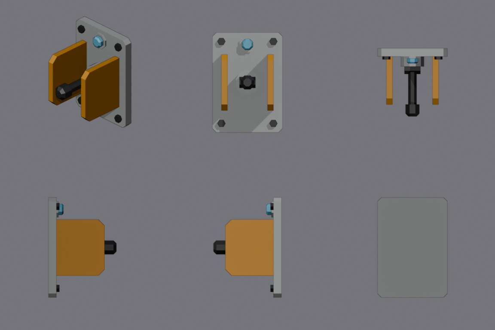

# Spike: an AI writes the CAD for a kit part

> **Superseded in part.** This first spike exported an Onshape-shaped glTF through `asset import`. The follow-up
> ([`scene_assembly_spike.md`](scene_assembly_spike.md)) dropped that for CAD solids assembled by Godot scenes, and
> the process is now [`../asset_process.md`](../asset_process.md). `tools/cad_spike/` and the `ai_toggle_switch` asset
> described below no longer exist; `guarded_toggle` in `tools/cadkit/scenes/` replaced them.

Issue #343. The question: can the hand-off line in the kit route move upstream, from "Tristan models the part in
Onshape and exports glTF" to "an agent writes a parametric CAD script and the pipeline takes it from there"? The
survey of what the field knows is in [`ai_code_cad_survey.md`](ai_code_cad_survey.md). This note records what was
built, what it measured, and what a production route would look like.

## What was built

`tools/cad_spike/` (its own `uv` project, build123d 0.13.0 pinned, about 870 MB of OCCT in the virtualenv):

- **`kitcad.py`**: the kit frame (X right, Y up, Z out of the panel, back face on Z=0, metres in the file), polygonal
  prisms with an explicit side count, an exporter that writes an **Onshape-shaped glTF** (`occurrence of <Part>` →
  `<Part>`, materials named by RGB value) so the existing `asset import` route accepts it unchanged, and two
  geometric assertions, `expect_one_solid` and `expect_bbox`.
- **`toggle_switch.py`**: a guarded toggle switch written the way an agent would write it. A parameter block, one
  function per part (housing, bolts, guard, bat, indicator lamp), the bat modelled in its own frame with the hinge
  on local X and placed with `hinge=(0, 0, 20)`, and assertions against the parameters before anything is exported.
- **`render_views.py`**: headless Blender Workbench renders of a GLB from six fixed views plus a contact sheet,
  about a second a view on CPU, for the agent to look at.

The generated glTF then went through the unchanged kit route: `asset import` (Blender weld, dissolve, flat shade,
pivot node, palette snap), `asset check`, `asset export` and `asset godot-check`.

## What it measured

| | Hand-modelled `toggle_switch` (Onshape) | Generated `ai_toggle_switch` (build123d) |
|---|---|---|
| Triangles after import | 4,606 | 388 |
| Kit triangle budget | 1,500 (fails) | 1,500 (passes) |
| Parts | 3 | 5, each its own node and palette role |
| Pivot | `Pivot` node at the hinge | `Pivot` node at the hinge, identity rotation |
| `check` gates | fails `triangles` | all pass |
| Godot import | yes | yes, all five surfaces use the vertex-colour material |
| Time per iteration | minutes in Onshape, export, import | about 25 s: 1 s geometry, 19 s Blender import, 5 s check |

The triangle count is low because every round feature is an 8- or 12-gon prism and every edge treatment is a
chamfer. That is a modelling discipline the prompt enforces, not a tessellation setting. Fillets and true cylinders
at default tolerance were what put the Onshape toggle over budget.

## What the loop caught, and in what order

Three generations were needed. Each failure was caught by a cheap mechanical check before any render:

1. **API drift** (two runs). build123d 0.13 renamed `add()` to `insert()` and made `is_valid` a property. The
   model's training data is older than the installed library. Pinning the version and keeping the installed docs in
   context is the mitigation the literature recommends; the compile-retry loop absorbed it.
2. **A silent placement bug** (one run). `insert()` inside a `with Locations(...)` block applies the location twice
   in 0.13, so the bolts landed outside the plate and the knob floated 36 mm past the end of the bat. The glTF was
   valid, the importer accepted it, and `check` passed with a size of 0.17 m instead of 0.10 m. The
   `expect_bbox` assertions against the parameter block are what flagged it; a render would also have shown it, a
   kernel validity check never would. This is the "valid but wrong" case the 2026 benchmarks are about.
3. **A design judgement** (one run). The first render showed the guard walls nearly the full plate height,
   occluding the bat from the front. One parameter edit (`GUARD_H`), and the hard-coded `PLATE_H - 24.0` that had
   crept in was made a parameter, which is the hard-coding drift [IterCAD](https://arxiv.org/html/2606.13368v2)
   warns of.

Nothing failed at the Blender, Godot or palette stages. The Onshape-shaped glTF contract is enough for the existing
importer to treat generated and hand-modelled parts identically.

## Conclusions

- **Viable.** For kit-scale parts (controls, fittings, bezels, lamps) an agent can author the CAD as a parametric
  script, and the result is better suited to the game than the hand-modelled export: a tenth of the triangles, parts
  split by role, palette colours by construction, and a regenerable source.
- **The hard gate is the product, not the generator.** Every defect was caught by assertions written against the
  brief before export. Renders were useful for the design judgement only. This matches the measured literature:
  "measure then claim" is the single biggest win; vision review is for qualitative questions.
- **The cost is the toolchain, not the model.** An 870 MB OCCT install per environment, API churn between build123d
  minor versions, and one Blender pass per iteration. All of it runs on CPU in the existing containers.
- **The hand-off line can move.** Tristan's role becomes writing the brief (dimensions, features, moving parts,
  palette roles) and reviewing renders, with Onshape kept for the sub hull and anything the agent cannot reach.

## A production route (proposal, not yet an arc)

A new build route `cadscript` beside `cad`, for the `kit` class and probably a `fitting` class for pipes, flanges,
valves and panel hardware:

1. **Brief.** `brief.md` gains a structured block: overall size, frame, a feature list with counts and positions,
   moving parts with hinge axis and limits, palette role per part, triangle budget.
2. **Author.** The agent writes `assets/models/<folder>/<slug>/<slug>_cad.py` against a small vendored kit library
   (the `kitcad.py` of this spike, grown into `tools/asset_pipeline/asset_pipeline/cadkit/`): frame helpers, prisms,
   chamfer-only edge treatments, standard fasteners and bezels, the Onshape-shaped exporter, and the assertion
   helpers. Prompt rules: parameter block at the top, one function per part, prisms with explicit side counts, no
   fillets, assertions against the brief before export, and the script may not print "done" until they pass.
3. **`asset cadgen <slug>`.** Runs the script in the pinned environment with a compile-retry cap of three, records
   the script's hash and the assertion report in the lineage, and hands the glTF to `asset import` unchanged.
4. **Review.** `render_views.py` becomes `asset views <slug>` and the Studio shows the contact sheet beside the
   existing Model tab preview; the agent or Tristan reviews qualitatively, capped at two rounds, and edits
   parameters rather than geometry.
5. **Library growth.** Each accepted part's reusable pieces (a bolt head, a bezel, a guard) move into the kit library
   so later parts compose verified pieces, which is where the literature says multi-feature generation fails.

Open questions for the `Concept:` issue:

- Where the OCCT dependency lives: inside `tools/asset_pipeline` (every pipeline user pays the install) or a
  separate `tools/cadkit` project the pipeline shells out to, as the spike does.
- Whether the native build123d `Compound` and `RevoluteJoint` route (richer, but needs the Blender face-merge and
  material fix) should replace the Onshape-shaped glTF contract, or whether the contract stays as the stable seam
  between CAD sources.
- How far the route reaches: kit parts are a clear fit; whole stations and the interior kit (`scripted` route,
  bpy today) may want the same B-rep discipline for their hard-surface pieces.
- `godot-check` renders kit-scale parts washed out under its white light (the black bat reads as white); the
  check scene was tuned for larger assets. Separate issue.
