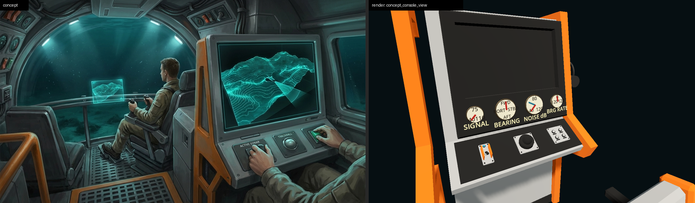
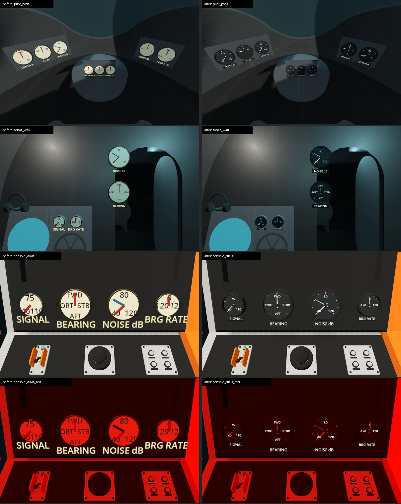
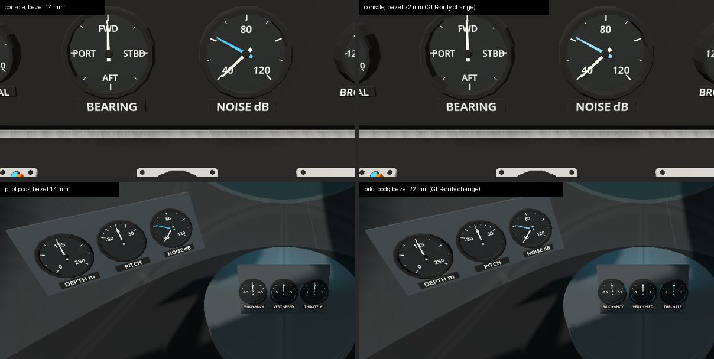
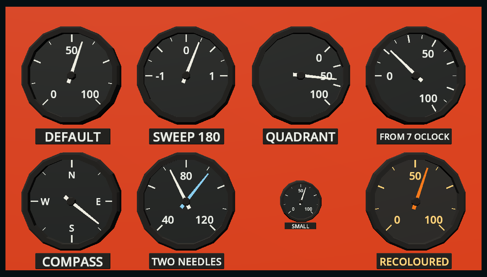

# Spike: concept-driven recursive scene assembly (sonar console)

Issue #345, following the code-CAD spike (#343). The proposed asset process was run once, by hand, in one session, on
the sonar console, to find where its rules are ambiguous before they go into the role doc and the pipeline. The
rules it produced are drafted in [`scene_assembly_policy.md`](scene_assembly_policy.md).

## Result

The process works. From a one-page brief and the locked cockpit concept, it produced a seven-scene tree. Every scene
was generated by a build script that checks its geometry against the brief before writing anything. The station
passes a headless Godot test of wiring, reach and sight lines from the seated eye. Two rounds of concept review
brought it close to the concept art.

## What was built

| Scene | Kind | Uses | Behaviour | Triangles |
| --- | --- | --- | --- | --- |
| `control_base` (1x1, 1x2, 2x2) | shared GLBs | — | — | 124 each |
| `push_button` | element | — | `PushButton` (new) | 108 |
| `guarded_toggle` | control | base 1x2 | `SwitchLever` | 268 + base |
| `trackball` | control | base 2x2 | `Trackball` (new) | 386 + base |
| `map_keypad` | control group | base 2x2, 4 × `push_button` | none of its own | 480 |
| `operator_seat` | furniture | — | bound by the parent | 376 |
| `gauge` (added by the follow-up) | display solids | — | `Gauge` (existing) | 320 |
| `sonar_console` | station | all of the above, plus the game's noise repeater, `FlatChart` and headset | `SonarStation`, `SonarSeat` | 3,042 in all (budget 12,000) |

Everything is under `assets/models/spike/`, built by `tools/cad_spike/build.py` from one script per scene in
`tools/cad_spike/components/`. The station's brief, breakdown and review are beside its scene:
[`brief.yaml`](../../assets/models/spike/stations/sonar_console/brief.yaml),
[`breakdown.md`](../../assets/models/spike/stations/sonar_console/breakdown.md),
[`review/review.md`](../../assets/models/spike/stations/sonar_console/review/review.md).

## What the checks caught, in order

1. **The toggle's knob cleared its guard by 5 mm too little at full swing.** The build script's swing check refused
   it; the guard grew from 52 to 64 mm and the lamp moved up. Nobody would have seen this in a render at rest.
2. **The seat's armrests overlapped the cushion edge.** Caught by its build check.
3. **The trackball's ball reached 12 mm behind the mount face, into a panel with no hole.** Caught in the first
   render, then made a rule for every panel part (`expect_in_front`). The ball now rests on its ring's lip, so the
   trackball needs nothing from the panel behind it.
4. **The palette rendered far too light.** Powder grey came out near white and orange came out yellow. The palette
   values are sRGB but were written into glTF, which is linear. This is very likely the cause of #344, and it affects
   the existing `asset import` route too (#348).
5. **Round 1 of the concept review**: four findings on the console and seat, fixed in round 2; two routed elsewhere.

## The concept review

The brief's two lists did the work. `compare_on` (massing, screen size, control placement and order, seat,
colour blocking) told the reviewer what to judge; `ignore` stopped it penalising the four dials the concept doesn't
draw, while still letting it judge **where** they went, which turned out to be the biggest massing problem.

| Round | Finding | Owner | Outcome |
| --- | --- | --- | --- |
| 1 | Dial header made an arcade-cabinet silhouette | console | Dials moved into the bezel's bottom border; console 14 cm lower |
| 1 | Orange read as a thin outline | console | Front-edge structural member |
| 1 | Controls on a light strip; the concept has dark pods | console | Dark inset |
| 1 | Seat read as an office chair | seat | Shoulder-height back, orange bolsters |
| 1–2 | Body lighter than the concept's grey; bezel can't be a second grey | palette | #348 |
| 1 | Dials look antique, which the art direction rejects | `Gauge` | #346 |
| — | Square chart in a 55 cm opening (found at breakdown) | `FlatChart` | #347 |

Cameras matched to the concept's viewpoints (`concept_console_view`, `concept_primary_view`) made the comparison
direct. Round 1 and round 2 sheets are in the review folder.

Limits of this review: the reviewer was the same session that built the asset, which is the bias the literature warns
about; in the pipeline it should be a fresh session with only the brief, the concept and the renders. The renders
show a blank screen (the chart draws nothing outside a running game) and no person for scale; both would make the
comparison fairer.

## Where the rules were ambiguous, and what settled them

- **The seat.** "It is touched, so it is a scene with its behaviour" didn't fit: the seat's script depends on the
  station (`SonarSeat` here). Settled: furniture scenes carry no behaviour; the parent binds it on a node above the
  instance.
- **The control base.** Reused but static. Settled: a reused static solid is a shared GLB that parents instance
  directly, not a `.tscn`.
- **The bezel.** "Plausibly reusable" could justify making it a scene, but it is sized to this console. Settled:
  build it local, and promote it to a scene on its second use.
- **The keypad.** A group of controls with no behaviour of its own. It is still a scene because it is reused as a
  unit; it exposes its keys by node name.
- **The toggle.** `ai_toggle_switch` from #343 fitted the function but had its own plate. Rebuilding it on the shared
  base changed its footprint, so it became a new slug (`guarded_toggle`) rather than a parameter tweak.
- **Concept against function.** The concept draws a trackball; the game trains the hydrophone with a handwheel. The
  breakdown took the concept's input and surfaced it as a decision (#349) instead of guessing silently.
- **Missing behaviour.** The trackball and the map keys needed scripts the game didn't have. In the pipeline those are
  development arcs that block the asset arcs; here they were written in their own commit to stand in for them.

## Propagation, which was the original question

Changing the shared base and rebuilding only the base **does** propagate: every control instances the base GLB, so
Godot picks up the change with no other rebuild. But it propagates the **geometry** without the **checks**. Moving
the base's bolts 14 mm further in put a bolt through the toggle's lamp, and a base-only rebuild wrote that without
complaint. The fix is cheap: `build.py` now runs every scene's checks before writing any file, and refused that
change with nothing written. A full rebuild of all seven scenes takes under 4 seconds and unchanged scenes come out
byte-identical, so the rule is simply "rebuild the whole tree". (The gauge follow-up below found a hole in this and
closed it.)

## Follow-up: restyling the shared gauge (#346)

A test of how an update to one asset reaches every scene that uses it, on the dial instrument: 19 gauges in the
sub interior and 4 on the generated console, 23 in all.

**What changed.** The gauge's shape moved from primitives built in `gauge.gd` to generated solids
(`tools/cad_spike/components/gauge.py`: bezel, backing, hub, title plate, and the needle as its own GLB), which the
script instances and scales to each gauge's radius. The look follows Tristan's reference: chunky dark bezel, dark
face, light needle and tick marks, title on a plate. The rim keeps the old outer radius and the mount keeps the old
depth, so nothing placed had to move.

**What propagated, and how.**

| Change | Files touched | Scenes that picked it up | Consumer scene files edited |
| --- | --- | --- | --- |
| The restyle (solids plus `gauge.gd`) | 2 GLBs, 1 script | all 23 gauges | none: `interior.tscn`, `noise_gauge.tscn` and `sonar_console.tscn` are byte-identical |
| Geometry only: bezel 14 → 22 mm deep | 1 GLB | all 23 gauges | none |
| A change that breaks a user: title plate moved down, off the console's bezel band | none (refused) | none | none |

A unit test pins the mechanism: every gauge in both scenes holds the **same mesh resource**.

**What it found.**

- **The first all-or-nothing build wasn't.** The console checks the gauge's envelope from the gauge's catalogue entry
  on disk, which was still the old one while checks ran, so a broken gauge was written before the console refused
  it. The build now snapshots the output tree and restores it on any failure.
- **The old second needle vanished under red light** (a blue that reflects no red). The new one is a lighter blue that
  shows at about half the first needle's brightness. The old dial as a whole was close to unreadable in red.
- **Labels were one size for every radius**, so small dials were buried under their own text. They now scale with the
  dial, and a long title shrinks to fit its plate.
- The console's triangle count had left its gauges out. With them it is 3,042 (budget 12,000).

**Details that vary per gauge** are instance settings, not geometry: the same solids with eight different settings.
Where the scale starts and stops is `sweep_deg` plus the new `sweep_center_deg`.

The general rule is the three tiers in the policy draft. Not done: the reference image's green indicator lamps under
each gauge. A lamp implies a function, so it belongs to a brief, as a `lamp` element from the catalogue.

## Cost

| Step | Time |
| --- | --- |
| Build all seven scenes (CAD, checks, GLBs, scenes, entries) | under 4 s |
| Godot import of changed GLBs | a few seconds |
| Six renders of the station (CPU Vulkan under Xvfb) | about 20 s |
| Spike unit tests (13) | a few seconds |

## Recommendations

1. **Accept the draft policy** and fold it into the graphic designer role doc.
2. **Map the loop onto the pipeline as discussed:** the station brief is the concept issue; the breakdown is the
   organization agent's plan, which Tristan approves; each new scene is an arc and the station's assembly arc is
   blocked by them; new behaviours are development arcs that block the scenes needing them.
3. **Make the concept review a separate session** with only the brief, the concept and the renders.
4. **Productise the tooling.** Move the spike's library (`kitcad`, `tscn`, the catalogue, the renderer and the
   review sheets) into `tools/asset_pipeline/` behind `asset` commands, with the catalogue in the Asset Studio.
   Decide where the 870 MB OCCT dependency lives (still open from #343).
5. **Resolve #348 first.** The colour-space bug affects every CAD asset, generated or imported.
